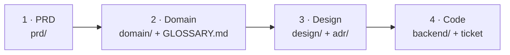

# Tài liệu Advanced Ticket System

Hệ thống **đặt vé xem phim theo ghế**: người xem chọn ghế trong một suất chiếu, giữ chỗ 15 phút, thanh
toán qua Stripe, rồi dùng mã QR để vào cổng. Mỗi ghế của một suất là một đơn vị bán (ADR-0003). Project
học tập để chứng minh năng lực backend ở **concurrency, tính đúng đắn, idempotency và hiệu năng đo được**.

## Bốn lớp

Mỗi lớp sinh ra lớp sau. Hướng dẫn cho AI: [`../AGENTS.md`](../AGENTS.md).

| Lớp | Ở đâu | Trả lời câu hỏi | Gate |
|---|---|---|---|
| 1 — PRD | [`prd/`](prd/) | Cho ai, phải làm gì, cố tình **không** làm gì | A — **đóng** |
| 2 — Domain | [`domain/`](domain/), [`../GLOSSARY.md`](../GLOSSARY.md) | Khái niệm, ranh giới, invariant, vòng đời | B — **đóng** |
| 3 — Design | [`design/`](design/), [`adr/`](adr/README.md) | Kiến trúc, dữ liệu, cơ chế concurrency, API, khuôn code | C — **đóng** |
| 4 — Code | `backend/`, [`../.scratch/advanced-ticket-system/issues/`](../.scratch/advanced-ticket-system/issues/) | Code chạy được, test chứng minh được | D — **đang mở** |

## Đang làm

**Gate D** — plan, milestone, exit checklist: [`plan/gate-d-implementation.md`](plan/gate-d-implementation.md).
Quy trình làm ticket: [`agents/dev-workflow.md`](agents/dev-workflow.md).

## Khác

| File | Nội dung |
|---|---|
| [`plan/00-roadmap.md`](plan/00-roadmap.md) | Mục tiêu, nguyên tắc, milestone |
| [`plan/traceability.md`](plan/traceability.md) | Ma trận FR ↔ BR ↔ J ↔ domain ↔ design ↔ ticket |
| [`learning/`](learning/README.md) | Bài học, nhật ký ticket, câu hỏi còn mở, khái niệm |
| [`agents/`](agents/) | Quy trình và quy ước cho AI / skill |

## Quy ước

- Tiếng Việt, thuật ngữ kỹ thuật giữ tiếng Anh; code và commit tiếng Anh.
- ID không bao giờ đánh số lại: `FR` `NR` `BR` `J` `INV` `R` `D` `B` `C` `#` `ADR`.
- Mỗi sự thật một nơi canonical; chỗ khác chỉ link. Lịch sử nằm ở git và ADR, không nằm trong docs.
- Mọi claim về tính đúng đắn / hiệu năng có test hoặc số đo đi kèm.
