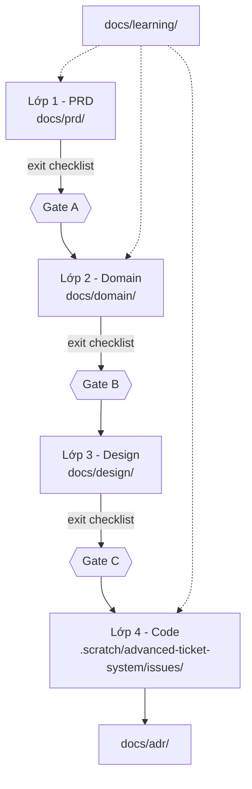

# Tài liệu Advanced Ticket System

Project học tập dùng để xây CV. Mục tiêu là chứng minh năng lực backend ở mức **concurrency,
tính đúng đắn, idempotency và hiệu năng đo được** — trên một nghiệp vụ đủ khó để các bài toán
đó xuất hiện tự nhiên.

> **Nghiệp vụ:** đặt vé xem phim. Người xem chọn **ghế** trong một suất chiếu, giữ chỗ có thời
> hạn, thanh toán, rồi mang mã QR tới cổng để vào rạp. Mô hình tồn kho là **seat-based**
> (mỗi ghế của suất chiếu là một đơn vị bán) — xem
> [`docs/adr/0003-seat-based-inventory.md`](adr/0003-seat-based-inventory.md).

## Bốn lớp

Tài liệu đi theo bốn lớp nối tiếp. Mỗi lớp **sinh ra** lớp sau, không đi trước.

| Lớp | Thư mục | Câu hỏi lớp này trả lời | Mở khi |
|---|---|---|---|
| 1 — PRD | [`docs/prd/`](prd/) | Hệ thống này dành cho ai, phải làm gì, và cố tình **không** làm gì? | ngay từ đầu |
| 2 — Domain | [`docs/domain/`](domain/) | Các khái niệm nghiệp vụ là gì, ranh giới ở đâu, invariant ra sao? | Gate A đóng |
| 3 — Design | [`docs/design/`](design/) | Kiến trúc, dữ liệu, cơ chế concurrency, hợp đồng API? | Gate B đóng |
| 4 — Code | [`.scratch/advanced-ticket-system/issues/`](../.scratch/advanced-ticket-system/issues/) | Mỗi ticket là một lát cắt dọc hoàn chỉnh | Gate C đóng |

Hỗ trợ:

- [`docs/plan/`](plan/) — plan tổng + plan chi tiết theo giai đoạn.
- [`docs/adr/`](adr/) — quyết định đã ghi lại. Trạng thái `provisional` nghĩa là còn phải xem lại ở gate ghi trong file.
- [`docs/learning/`](learning/) — nhật ký học tập: mỗi session học được gì, vấp ở đâu, còn câu hỏi nào mở.

## Gate và exit checklist

Đánh dấu `[x]` khi điều kiện thực sự đạt. Không tick để "cho có".

### Gate A — PRD đủ để làm ra domain model

- [x] `docs/prd/00-overview.md` — vấn đề, actors, jobs, success criteria
- [x] `docs/prd/01-requirements.md` — requirements đánh số `FR-nn` (`FR-01..FR-39`)
- [x] `docs/prd/02-non-requirements.md` — những gì cố tình không làm, kèm lý do (`NR-01..NR-15`)
- [x] `docs/prd/03-user-journeys.md` — đặt vé, mở bán phim hot, check-in từng bước (`J-01..J-07`)
- [x] `docs/prd/04-business-rules.md` — luật nghiệp vụ (`BR-01..BR-30`)
- [x] Mỗi actor trong overview có ít nhất một job trong user journeys
- [x] Mỗi `FR-nn` có thể truy vết tới một hành vi trong user journeys
- [x] Không từ khoá kỹ thu nào lọt vào các file ở Lớp 1
- [x] Mọi requirement có dòng "Kiểm chứng"
- [x] Ma trận truy vết trong `docs/plan/00-roadmap.md` đã điền các `FR-nn` tương ứng
- [x] `docs/learning/log.md` có mục tổng kết Gate A

### Gate B — Domain đủ để làm ra kiến trúc

- [x] `docs/domain/ubiquitous-language.md` — thuật ngữ đã chốt, từ nào tránh dùng (T05, 27 thuật
  ngữ trong 6 nhóm — bản làm việc, sẽ gom vào `GLOSSARY.md` ở cuối Gate B)
- [ ] `docs/domain/context-map.md` — bounded context và quan hệ giữa chúng
- [ ] `docs/domain/aggregates.md` — aggregate, boundary, invariant
- [ ] `docs/domain/state-machines.md` — vòng đời booking, payment, ticket, seat
- [ ] `docs/domain/cross-context-contracts.md` — hợp đồng giữa các context
- [ ] `GLOSSARY.md` ở root (single-context) hoặc `GLOSSARY-MAP.md` + glossary per context
- [ ] Mỗi `FR-nn` của Gate A map được tới ít nhất một khái niệm domain
- [ ] ADR-0003 đã được xem lại: chốt hay đổi? (đặc biệt: một suất chiếu có phải là một aggregate không)

### Gate C — Design đủ để viết code

- [ ] `docs/design/architecture.md` — cấu trúc module, quy tắc phụ thuộc
- [ ] `docs/design/data-model.md` — schema, index, constraint
- [ ] `docs/design/concurrency.md` — mỗi bài toán có cơ chế **và** test chứng minh
- [ ] `docs/design/api-contract.md` — endpoint, error code, idempotency contract
- [ ] ADR đủ cho mọi quyết định khó đảo ngược đã gặp
- [ ] Ma trận truy vết trong `docs/plan/00-roadmap.md` đầy đủ: mỗi `FR-nn` có ít nhất một ticket

### Gate D — Code đủ để đưa lên CV

- [ ] Không bán trùng ghế dưới tải tranh chấp, **chứng minh bằng test**
- [ ] Đặt n ghế là all-or-nothing: giữ được đủ n hoặc không giữ ghế nào
- [ ] Không kẹt (deadlock) khi hai người tranh ghế chồng nhau theo thứ tự ngược nhau
- [ ] Idempotency ở booking, webhook, check-in
- [ ] `perf/baseline.csv` có dòng trước và sau mỗi lần tối ưu
- [ ] Test integration chạy trên Postgres và Redis thật (Testcontainers), không dùng InMemory
- [ ] README có sơ đồ kiến trúc, bảng số liệu, link ADR
- [ ] CI xanh, repo public, không có secret nào trong commit

## Quy ước

- Ngôn ngữ: tiếng Việt, thuật ngữ kỹ thu giữ tiếng Anh.
- Requirement đánh số `FR-nn`; ticket trích dẫn qua trường `Traces to:`.
- ADR ở `docs/adr/`, đánh số liên tục, format theo `docs/agents/domain.md`. ADR bị thay thế
  giữ lại lịch sử với `status: superseded by ADR-NNNN` — **đừng xoá**.
- Mỗi ticket là một lát cắt **dọc**: schema + API + test, đi hết một đường, chứ không phải một lát cắt ngang theo tầng.
- Mọi claim về hiệu năng hoặc tính đúng đắn cần test hoặc số đo đi kèm.

Chi tiết về vai trò AI và cách làm việc: [`AGENTS.md`](../AGENTS.md).
