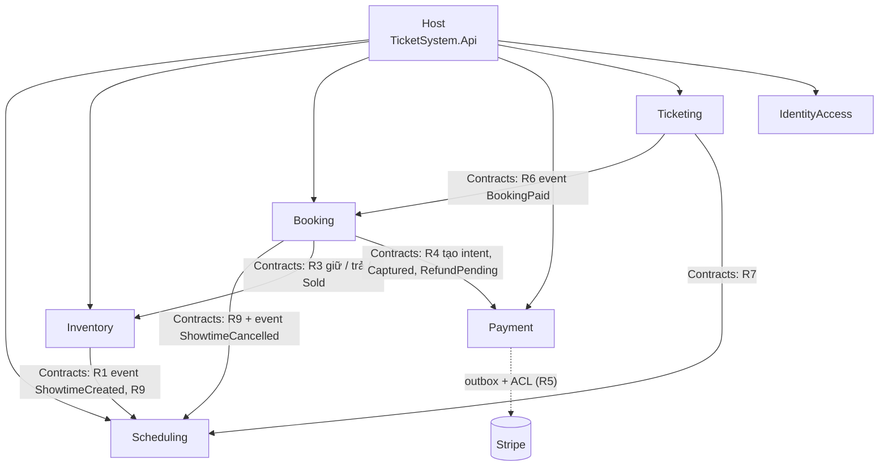

# Architecture — module và ranh giới phụ thuộc

Lớp 3 — Design.

Nguồn: [`../domain/context-map.md`](../domain/context-map.md) (6 context, R1–R9),
[`../domain/cross-context-contracts.md`](../domain/cross-context-contracts.md) (5 ranh giới bị
cắt), [`../domain/aggregates/`](../domain/aggregates/), ADR-0005, ADR-0006, ADR-0007.
Thuật ngữ: [`../../GLOSSARY.md`](../../GLOSSARY.md).

ADR liên quan: [ADR-0008](../adr/0008-cross-module-transaction.md) (D3),
[ADR-0009](../adr/0009-module-communication.md) (D4, D9),
[ADR-0010](../adr/0010-payment-intent-states.md) (tên trạng thái `Payment intent`).

Kiến trúc ở đây không phải "folder nào chứa file nào", mà là **module nào biết gì về module nào**.

---

## Stack

| Hạng mục | Quyết định |
|---|---|
| Runtime | .NET 10 (`net10.0`, LTS) |
| API | ASP.NET Core Controllers + `[ApiController]` |
| Data | EF Core (write, migrations) + Dapper (read path nóng) + raw SQL (câu tranh chấp) — xem D7 |
| Database | PostgreSQL, schema riêng theo module, **mỗi module 1 `DbContext`**, chung connection + transaction qua Unit of Work (D3) |
| Cache | Redis (`StackExchange.Redis`) trực tiếp |
| Auth | `JwtBearer` tự viết, refresh token rotation + reuse detection |
| Payments | Stripe PaymentIntent + webhook idempotent theo `event.id` |
| Tickets / check-in | HMAC-SHA256 signed QR, verify chữ ký tại server khi quét, chống quét lại (không hỗ trợ offline) |
| Test | xUnit + Shouldly + Testcontainers (Postgres + Redis thật) |
| Load test | k6 (Docker image `grafana/k6`) |
| Observability | Serilog + correlation ID → OTel / Prometheus / Grafana |
| Infra | Docker Compose, GitHub Actions, GitHub repo public |
| Config | `appsettings.json` non-secret + user-secrets + biến môi trường |

Quy tắc dùng nhiều tầng: **một hot path chỉ đi qua một tầng truy cập dữ liệu**.

---

## Tóm tắt quyết định

| # | Quyết định |
|---|---|
| D1 | 6 module, một module ứng với một bounded context, không gộp |
| D2 | Mỗi module 2 project: `<Module>` (nội bộ) + `<Module>.Contracts` (public) |
| D3 | Mỗi module một `DbContext` (schema riêng); mọi module dùng **chung một connection + một transaction** qua Unit of Work theo request |
| D4 | Ba cách gọi giữa module, chọn theo use case: interface / event trong transaction / outbox |
| D5 | Mỗi bảng có đúng một module sở hữu; chỉ module đó được ghi **và** đọc trực tiếp |
| D6 | `Shared` chia hai project, không chứa thuật ngữ domain |
| D7 | EF Core / Dapper / SQL tay: mỗi thao tác một tầng, chọn theo bảng |
| D8 | Outbox: một bảng **mỗi module**, một dispatcher chung ở host |
| D9 | Đồ thị phụ thuộc không vòng; R4, R6 chọn một hướng compile-time, chiều kia bằng event |
| D10 | Điều kiện tách service: điều kiện cấu trúc + ngưỡng đo ở bước load test |

---

## Vì sao modular monolith

Câu hỏi quyết định: **có bài toán concurrency nào bắt buộc một DB transaction xuyên context không?**
Có — năm chỗ (xem [`cross-context-contracts.md` — "Ranh giới bị cắt"](../domain/cross-context-contracts.md#ranh-giới-bị-cắt--năm-chỗ)):

| # | Ranh giới bị cắt | Module ghi chung transaction | Bài toán concurrency (roadmap) |
|---|---|---|---|
| 1 | Giữ n ghế: đủ n hoặc không ghế nào; đơn và ghế cùng hạn | `Booking` + `Inventory` (đọc `Scheduling`) | #1, #2, #3, #13 |
| 2 | Thu tiền ⇒ `Paid` ⇒ `Sold` ⇒ cấp vé, đúng một lần | `Payment` + `Booking` + `Inventory` + `Ticketing` | #4, #7 |
| 3 | Hết hạn / huỷ đơn: trả ghế + chuyển đơn cùng lúc | `Booking` + `Inventory` (+ `Payment` ghi outbox) | #4 |
| 4 | Hủy suất: huỷ đơn chờ + yêu cầu hoàn mọi đơn đã trả | `Scheduling` + `Booking` + `Inventory` + `Payment` | #7 |
| 5 | Suất tồn tại ⇔ ghế của suất tồn tại đủ | `Scheduling` + `Inventory` | — |

Nếu tách service ngay, cả năm chỗ phải chuyển sang saga / compensating transaction, tức là sẽ có
những khoảng thời gian hệ thống **đang vi phạm** bất biến. Ví dụ: ghế đã `Held` mà chưa có
`Booking` (#1), hoặc `Paid` mà chưa có vé (#2). Bài #2 (all-or-nothing) và #13 (khoá quota trước
khi đếm) chỉ chứng minh được khi giữ ghế, khoá quota và tạo đơn nằm trong **một** transaction.
Tách service sớm vì vậy là sai: nó đổi một bất biến chứng minh được bằng test thành một bất biến
chỉ "cuối cùng sẽ đúng".

Modular monolith giữ được **ranh giới ngôn ngữ và quyền sở hữu dữ liệu** của context map (ranh
giới project, schema riêng) mà **không** cắt transaction.

> **Quy tắc cứng:** không "tối ưu" bằng cách chia một trong năm transaction trên thành nhiều
> transaction nếu không đổi logic tương ứng. Mỗi lần định làm thế phải có ADR.

---

## D1 — 6 module

| Module | Context | Trách nhiệm |
|---|---|---|
| `Scheduling` | Lịch chiếu | `Movie`, `Room`, `Room seat`, `Showtime`, `Ticket price` |
| `Inventory` | Tồn kho ghế | `Showtime seat`, thông tin giữ, `Blocked` |
| `Booking` | Đặt vé | `Booking`, `Booking line`, quota theo (người xem, suất), `Idempotency key` |
| `Payment` | Thanh toán | `Payment intent`, `Payment event`, `Refund`, ACL với Stripe |
| `Ticketing` | Vé và check-in | `Ticket`, `Check-in`, `Gate assignment` |
| `IdentityAccess` | Danh tính và phân quyền | `User`, vai trò, refresh token |

Không gộp `Inventory` vào `Booking` dù #1 và #3 luôn chạm cả hai: `Inventory` có hành vi riêng
không dính đơn (chặn ghế, sinh ghế khi tạo suất, bốn con số R2), và R2 là ứng viên tách service
hàng đầu. Gộp lại thì mất cả hai.

---

## D2 — Cấu trúc project

Mỗi module có hai project:

- **`TicketSystem.<Module>.Contracts`** — public: interface dịch vụ, DTO, event mà module khác
  được dùng. Không chứa logic, không reference EF Core / Dapper / ASP.NET Core.
- **`TicketSystem.<Module>`** — nội bộ: domain, use case, `DbContext`, SQL, controller. Module
  khác **không bao giờ** reference project này. Chỉ host reference nó (để đăng ký DI và
  controller).

Ranh giới là ranh giới **compile-time**: muốn gọi class nội bộ của module khác thì không có
`ProjectReference` để gọi. Kiểm tra được bằng compiler, không phụ thuộc kỷ luật.

### Bố cục repo: backend và frontend

Repo chứa hai ứng dụng dùng hai toolchain khác nhau (.NET và Node). Mỗi ứng dụng có **thư mục
riêng, tự chứa toàn bộ cấu hình build của nó**. Gốc repo chỉ giữ những thứ thuộc về **cả hệ
thống**.

```
advanced-ticket-system/
  README.md, AGENTS.md, GLOSSARY.md
  docs/  .scratch/                tài liệu, ticket
  .gitignore                      chỉ luật chung: .env, secrets.json, file của OS/IDE
  .github/workflows/
    backend.yml                   chạy khi backend/** đổi
    frontend.yml                  chạy khi frontend/** đổi
  docker-compose.yml              môi trường dev của cả hệ thống: Postgres, Redis
  .env.example                    biến cho compose (.env thật bị gitignore)
  infra/postgres/init/            script khởi tạo DB (btree_gist)
  perf/                           k6 — bắn vào API qua HTTP, không thuộc backend hay frontend
  backend/                        mọi thứ của .NET
    TicketSystem.sln
    global.json                   ghim SDK 10 — chỉ có hiệu lực trong backend/
    Directory.Build.props         net10.0, nullable, TreatWarningsAsErrors
    .editorconfig                 luật C#
    .gitignore                    bin/, obj/, *.user
    src/   tests/                 (cây ở dưới)
  frontend/                       SPA cho người xem — package.json, vite config, .gitignore riêng
```

**Vì sao chọn:**

- **Mỗi toolchain một thư mục gốc riêng.** Cấu hình của .NET (`global.json`, `Directory.Build.props`)
  và của Node (`package.json`, `node_modules/`) đều áp dụng **từ thư mục chứa nó trở xuống**. Để
  chung một gốc thì cấu hình của bên này lan sang bên kia: `global.json` chi phối mọi lệnh
  `dotnet` chạy bất kỳ đâu trong repo, còn tool quét file của frontend phải tự bỏ qua `bin/`, `obj/`.
- **Frontend chỉ là một client của `api-contract.md`**, giống k6 hay Stripe.js. Nó không reference
  code nào của backend, nên không có lý do để nằm trong .NET solution. Biên giới giữa hai bên là HTTP.
- **CI tách theo đường dẫn:** đổi frontend không phải build lại .NET, và ngược lại.
- **Compose, `infra/`, `perf/` ở gốc**, vì chúng phục vụ cả hệ thống chứ không riêng ứng dụng nào.
  Sau này compose có thể chạy thêm `api` và `web`.

**Không chọn:**

- *Solution và cấu hình .NET ở gốc repo, frontend ở `web/`*: gốc repo bị
  lẫn file của backend, và cấu hình .NET áp lên cả phần frontend.
- *Monorepo kiểu `apps/` + `packages/` với Nx hoặc Turborepo*: những công cụ này giải quyết việc
  chia sẻ code giữa nhiều package JS. Ở đây chỉ có một ứng dụng .NET và một SPA, không có code
  chung, nên tooling là thừa.
- *Frontend ở repo riêng*: dự án chỉ có một người làm. Một repo giữ CI, README và link CV ở cùng
  một chỗ, và một PR có thể đổi API và UI cùng lúc.
- *Backend render UI (Razor / Blazor Server)*: trộn UI vào host. Load test khi đó sẽ đo lẫn cả
  phần render.

### Cấu trúc thư mục backend

Mọi đường dẫn dưới đây tính từ `backend/`.

```
TicketSystem.sln
src/
  Host/
    TicketSystem.Api/                       composition root: Program.cs, middleware, auth,
                                            Unit of Work theo request, outbox dispatcher
  Shared/
    TicketSystem.Shared.Abstractions/       Results/, Domain/, Application/ — kiểu và interface kỹ thuật (xem D6)
    TicketSystem.Shared.Infrastructure/     Persistence/, Web/, Observability/: UoW, event bus, decorator, outbox
  Modules/
    Scheduling/
      TicketSystem.Scheduling.Contracts/
      TicketSystem.Scheduling/
        Domain/          aggregate (AggregateRoot), value object (ValueObject), invariant
        Application/     use case: <UseCase>/ chứa Command/Query + Handler hiện thực interface (building-blocks.md B6)
        Infrastructure/  SchedulingDbContext, migrations, repository, SQL tay
        Api/             controller, Requests/, Responses/
        SchedulingModule.cs   AddSchedulingModule(...) — điểm đăng ký duy nhất
    Inventory/   (cùng khuôn)
    Booking/     (cùng khuôn)
    Payment/     (cùng khuôn; thêm Infrastructure/Stripe/ — ACL)
    Ticketing/   (cùng khuôn)
    IdentityAccess/ (cùng khuôn)
tests/
  TicketSystem.ArchitectureTests/           kiểm tra quy tắc phụ thuộc + lớp / public / value object (xem dưới)
  TicketSystem.Testing/                     dùng chung: fixture Testcontainers, ApiFactory, helper token / concurrency
  TicketSystem.IntegrationTests/            Testcontainers: Postgres + Redis thật
  Modules/TicketSystem.<Module>.Tests/      unit domain + integration của module (một project mỗi module)
```

`perf/` (k6) nằm ở **gốc repo**, không nằm trong `backend/` — xem bố cục repo ở trên.

---

## D3 — Transaction xuyên module

**Cơ chế:**

1. Host mở **một** `NpgsqlConnection` và **một** `DbTransaction` cho mỗi request (hoặc mỗi lượt
   worker) — đối tượng `IUnitOfWork` có scope theo request.
2. Mỗi module có `DbContext` riêng với `HasDefaultSchema("<module>")`. `DbContext` được tạo trên
   **connection có sẵn** đó và gắn vào transaction đang mở (`Database.UseTransaction`).
3. SQL tay / Dapper của module dùng **cùng** connection + transaction.
4. Commit một lần ở cuối use case; exception ở bất kỳ module nào ⇒ rollback toàn bộ.

Kết quả: năm ranh giới bị cắt là **một** transaction Postgres thật, trong khi mỗi module vẫn chỉ
map bảng của schema mình.

**Không chọn:**

- *Một `DbContext` chung* (quyết định cũ ở roadmap): transaction tự nhiên là một, nhưng
  `DbContext` đó phải biết entity của mọi module ⇒ module nào cũng `Set<T>()` được bảng của
  module khác. "Không đọc bảng của nhau" chỉ còn là kỷ luật.
- *`TransactionScope`*: nếu hai `DbContext` vô tình mở hai connection thì transaction bị nâng
  thành distributed transaction. Khó kiểm soát, khó test, và che mất việc "một connection".

**Hệ quả:**

- Migrations **theo module**: mỗi `DbContext` có bảng lịch sử migration trong schema của nó.
- Khi tách một module thành service, đây là chỗ đầu tiên phải đổi: connection chung không
  còn ⇒ ranh giới bị cắt của module đó phải thành saga (xem D10).

---

## D4 — Module gọi nhau thế nào

Chọn theo use case, bằng hai câu hỏi và một ràng buộc:

| Bên gọi cần kết quả để quyết định? | Phần phía sau phải atomic? | Hướng | Dùng |
|---|---|---|---|
| Có | Có | downstream → upstream | **Interface** trong `<Upstream>.Contracts`, gọi đồng bộ trong transaction |
| Không | Có | upstream → downstream | **Event in-process**: upstream định nghĩa event trong `.Contracts` của mình, downstream đăng ký; handler chạy **trước commit**, exception ⇒ rollback |
| Không | Không, hoặc chạm hệ thống ngoài | bất kỳ | **Event qua outbox**: ghi một dòng trong transaction, xử lý **sau commit** (D8) |

**Ràng buộc:** hướng reference phải theo đồ thị ở D9. Upstream không bao giờ reference
`.Contracts` của downstream. Khi upstream cần kích hoạt downstream thì dùng event.

**Không chọn mediator giữa module** (MediatR hoặc tự viết): so với interface nó không thêm gì,
lại che mất hướng phụ thuộc (vẫn phụ thuộc kiểu command, chỉ là không thấy trong `.csproj`).
Dùng mediator *bên trong* một module — **cũng không**; mỗi use case một handler hiện thực interface,
controller gọi thẳng ([ADR-0017](../adr/0017-handler-per-use-case-no-mediator.md),
[ADR-0018](../adr/0018-domain-and-application-primitives.md), [`building-blocks.md`](building-blocks.md) B6).
Event giữa module là **integration event** (`IIntegrationEvent`, type ở `.Contracts` của bên phát), do bên phát
dịch từ domain event của mình; publish tường minh trước commit (B13, ADR-0019).

### Áp vào năm ranh giới bị cắt

| # | Luồng | Cách gọi |
|---|---|---|
| 1 | Giữ ghế | `Booking` đọc `Scheduling.Contracts` (R9, trong transaction) → khoá quota → **interface** `Inventory.Contracts` giữ n ghế, trả về ghế nào thất bại (`FR-15`) → tạo `Booking` |
| 2 | Thanh toán thành công | `Payment` ghi `Payment event` (unique `event.id`) → **event in-tx** `PaymentSucceeded` → `Booking` thử `→ Paid` (cần `expires_at > now()`). Được: **interface** `Inventory` đánh dấu `Sold`, **interface** `Payment` → `Captured`, **event in-tx** `BookingPaid` → `Ticketing` cấp vé. Không được: **interface** `Payment` → `RefundPending` + outbox |
| 3 | Hết hạn / người xem huỷ | `Booking` (worker hoặc request) → `Expired` / `Cancelled` → **interface** `Inventory` trả ghế theo `hold_id` → **interface** `Payment`: intent `Unpaid → Closed` + **outbox** huỷ phía Stripe (nếu có intent) |
| 4 | Hủy suất | `Scheduling` → `Cancelled` → **event in-tx** `ShowtimeCancelled` → `Booking`: huỷ đơn chờ (+ trả ghế qua interface `Inventory`), với đơn `Paid` gọi **interface** `Payment` → `RefundPending` + **outbox** gọi Stripe |
| 5 | Tạo / xoá suất | `Scheduling` → **event in-tx** `ShowtimeCreated` (mang danh sách `Room seat` + `Seat type`, đúng R1) → `Inventory` sinh `Showtime seat`. Xoá suất `NotOnSale` tương tự với `ShowtimeDeleted` |

Ở #4, `Payment` không nghe `ShowtimeCancelled` trực tiếp. `Booking` là bên biết đơn nào đã
trả tiền, nên `Payment` không cần biết "suất chiếu" là gì.

---

## D5 — Quyền sở hữu bảng

Mỗi module là **một schema Postgres**. Chỉ module sở hữu được **ghi và đọc trực tiếp** bảng của
mình. Module khác đi qua `.Contracts`. Tên bảng ở đây là tên khái niệm; cột, index, constraint
xem [`data-model.md`](data-model.md).

| Schema / module | Bảng (khái niệm) | Ghi chú |
|---|---|---|
| `scheduling` | `movies`, `rooms`, `room_seats`, `showtimes`, `ticket_prices` | `room_seats` tĩnh, ghi hiếm |
| `inventory` | `showtime_seats`, `outbox_messages` | Bảng nóng nhất hệ thống; **chỉ `Inventory` được ghi** |
| `booking` | `bookings`, `booking_lines`, `booking_history`, `idempotency_records`, `outbox_messages` | Khoá quota = advisory lock theo (người xem, suất) — ADR-0007 |
| `payment` | `payment_intents`, `payment_events`, `refunds`, `outbox_messages` | |
| `ticketing` | `tickets`, `check_ins`, `gate_assignments` | |
| `identity` | `users`, `role_changes`, `refresh_tokens` | |

**`room_seats` và `showtime_seats` thuộc hai module khác nhau — có chủ ý.** Hai bảng khác nhau ở
mọi mặt quan trọng:

| | `scheduling.room_seats` | `inventory.showtime_seats` |
|---|---|---|
| Vòng đời | Theo phòng, gần như không đổi | Theo suất, sinh khi tạo suất, đổi trạng thái liên tục |
| Tần suất ghi | Hiếm (quản lý rạp sửa sơ đồ) | Rất cao khi mở bán phim hot |
| Ai tranh chấp | Không ai | Hàng trăm người xem cùng lúc |
| Nguồn sự thật | Sơ đồ vật lý | Trạng thái bán |

Để chung một module thì phần nóng (khoá dòng, cache, tối ưu) dính vào phần tĩnh, và R2 không
còn tách riêng được. Cầu nối duy nhất là event `ShowtimeCreated` (#5). `Inventory` **chép** loại
ghế lúc sinh ghế và không đọc lại `room_seats`.

---

## D6 — `Shared` chứa gì

| Project | Chứa | Ai reference |
|---|---|---|
| `Shared.Abstractions` | `Results/`: `Result` / `Error` / `ErrorType` / `PagedResponse<T>` (ADR-0016). `Domain/`: `Entity<TId>`, `AggregateRoot<TId>`, `ValueObject`, `IDomainEvent`, `IEntityId` (ADR-0018). `Events/`: `IIntegrationEvent`, `IEventPublisher`, `IEventHandler<T>` (ADR-0019). `Application/`: `ICommand` / `IQuery`, `ICommandHandler` / `IQueryHandler`, `ICurrentUser`, `IOutboxWriter`, `IUnitOfWork` | Mọi project |
| `Shared.Infrastructure` | `Persistence/`: hiện thực UoW trên Npgsql, `ModuleDbContext` + quy ước EF, type handler Dapper, cấu hình bảng outbox dùng lại cho từng schema. Bus event in-process, decorator log / trace, quét đăng ký handler, outbox dispatcher. `Web/`: map `Result` → problem+json, exception handler, JSON options, `ApiControllerBase`, OpenAPI, plumbing JWT / policy (ADR-0016; có `FrameworkReference` ASP.NET Core). `Observability/`: Serilog, correlation ID, health | Project nội bộ của module + host. **Không** `.Contracts` nào reference |

Thời gian dùng `System.TimeProvider` built-in, không có interface tự viết ([`building-blocks.md`](building-blocks.md) B10).
Bảng đầy đủ thành phần dùng chung nằm ở [`building-blocks.md`](building-blocks.md) B12; base class domain
và handler interface là quyết định của [ADR-0018](../adr/0018-domain-and-application-primitives.md) — chúng
thoả luật 2 vì cả 6 module dùng ngay từ module đầu tiên.

**Ba luật để `Shared` không thành "thùng rác":**

1. **Không chứa từ nào có trong `GLOSSARY.md`.** `Shared` là kỹ thuật thuần. `ShowtimeId` nằm ở
   `Scheduling.Contracts`, `BookingId` ở `Booking.Contracts`. Ai cần thì reference module đó theo
   đúng hướng D9.
2. **Chỉ thêm khi ≥ 2 module cần ngay bây giờ**, không thêm "phòng khi sau này cần".
3. **Không chứa luật nghiệp vụ.** Có `if` mang ý nghĩa nghiệp vụ ⇒ nó thuộc về một module.

`hold_id` của `Inventory` là kiểu riêng của `Inventory`, không phải `BookingId`
(cặp thuật ngữ khác nghĩa #4 ở `cross-context-contracts.md`). `Booking` truyền id đơn vào làm
giá trị của nó. `Inventory` không diễn giải giá trị đó.

---

## D7 — EF Core, Dapper, SQL tay

Luật của roadmap: **một hot path chỉ đi qua một tầng truy cập dữ liệu.**

| Loại thao tác | Tầng | Vì sao | Ví dụ |
|---|---|---|---|
| Lệnh tranh chấp (điều kiện lệnh, thứ tự khoá) | **SQL tay** (chạy qua Dapper, cùng transaction) | Cần `UPDATE ... WHERE status = 'Available' ... RETURNING`, khoá theo thứ tự `ORDER BY id`, biết **ghế nào** thất bại. `ExecuteUpdate` của EF chỉ trả số dòng | Giữ ghế, trả ghế theo `hold_id`, `Held → Sold`, khoá quota, `INSERT ... ON CONFLICT` của check-in và `Payment event` |
| Đọc nóng | **Dapper** | Không cần change tracking; projection thẳng ra DTO | Sơ đồ ghế của suất (khi cache miss), bốn con số R2 |
| Ghi aggregate ít tranh chấp | **EF Core** | Mapping, change tracking, migrations | Tạo phim, phòng, suất; đăng ký người dùng; phân công cổng |
| Schema | **EF Core migrations** theo module | Mỗi module một lịch sử migration | — |

Cả luồng giữ ghế (#1) đi bằng SQL tay / Dapper, **kể cả phần tạo `Booking`**, để đúng luật một
hot path một tầng. Mỗi câu SQL tay nằm trong module sở hữu bảng đó, và ghi rõ vì sao ORM không
biểu đạt được (quy tắc ở `docs/design/README.md`).

---

## D8 — Outbox

**Vì sao có:** có những việc phải xảy ra **khi và chỉ khi** transaction commit, nhưng lại không
nằm trong transaction được: gọi Stripe (hoàn tiền, huỷ intent — ADR-0006), vô hiệu cache Redis,
gửi email. Gọi thẳng thì hoặc gọi rồi mà transaction rollback, hoặc commit rồi mà gọi thất bại.

**Ranh giới:**

- **Trong transaction:** module ghi một dòng vào `<schema>.outbox_messages` của chính nó, cùng
  transaction với thay đổi trạng thái.
- **Ngoài transaction:** một dispatcher (hosted service ở host) đọc các bảng outbox bằng
  `FOR UPDATE SKIP LOCKED`, gọi handler của module sở hữu, đánh dấu đã xử lý.
- **At-least-once:** handler phải idempotent. Gọi Stripe luôn kèm `Idempotency-Key` (ADR-0006).

**Một bảng mỗi module, không phải một bảng chung:** bảng chung ở `shared` thì mọi module cùng ghi
vào một bảng, trái với D5 (mỗi bảng một chủ). Khi tách một module ra service, outbox của nó đi
theo nó.

Dùng outbox cho: `Payment` (hoàn tiền, huỷ intent phía Stripe), `Inventory` (vô hiệu cache sơ đồ
ghế; cơ chế cache: ghi đè từng ghế theo version, ADR-0012, bài toán #10), `Booking` (sự kiện cần thông báo ra ngoài, nếu
có).

**Event in-process (D4) khác outbox:** event in-process chạy **trong** transaction và là một
phần của ranh giới bị cắt. Outbox chạy **sau** commit và không bao giờ là một phần của bất biến.

---

## D9 — Đồ thị phụ thuộc



Mũi tên `A → B` nghĩa là **project nội bộ của A reference `B.Contracts`**. Mọi module được
reference `IdentityAccess.Contracts` (R8), nhưng không vẽ để sơ đồ đỡ rối.

**R4 và R6 là quan hệ hai chiều về dữ liệu**, nên phải chọn một hướng compile-time:

- **`Booking → Payment.Contracts`.** `Payment` không biết `Booking` là gì: nó nhận id đơn và số
  tiền làm tham số, rồi báo kết quả bằng event `PaymentSucceeded` / `PaymentFailed` trong
  `Payment.Contracts`. Giữ `Payment` + ACL Stripe độc lập.
- **`Ticketing → Booking.Contracts`.** `Ticketing` nghe `BookingPaid` (mang id đơn, người xem,
  suất, danh sách ghế). Xem vé của một đơn là endpoint của `Ticketing`, nên `Booking` không cần
  reference `Ticketing`.
- **R2 (bốn con số)** được phục vụ bởi **endpoint của `Inventory`**, không phải `Scheduling` đọc
  `Inventory`. Nếu `Scheduling` reference `Inventory.Contracts` thì sẽ thành vòng với R1.
- **Sơ đồ ghế của suất (`FR-13`)** cũng là endpoint của **`Inventory`**: nó lấy bố cục phòng (hàng,
  số) và giá theo loại ghế từ `Scheduling.Contracts`, ghép với trạng thái ghế của chính nó, rồi cache
  (bài toán #9, #10). Chỉ `Inventory` ghép được mà không tạo vòng, vì nó là bên duy nhất được
  phép biết cả hai phía.

### Quy tắc phụ thuộc (kiểm được)

Mỗi quy tắc có một architecture test ở `tests/TicketSystem.ArchitectureTests/`. Test
đọc `ProjectReference` và kiểm assembly bằng reflection.

1. **Project nội bộ của một module không reference project nội bộ của module khác.** Chỉ được
   reference `.Contracts` của module khác, `Shared.Abstractions`, `Shared.Infrastructure`.
2. **Project `.Contracts` chỉ reference `Shared.Abstractions`**, không reference EF Core, Dapper,
   Npgsql, ASP.NET Core hay `.Contracts` khác.
3. **Đồ thị module không có vòng** và chỉ gồm các cạnh ở sơ đồ D9 (cộng `IdentityAccess`).
   Thêm cạnh mới phải sửa tài liệu này trước.
4. **Chỉ `Inventory` ghi `inventory.showtime_seats`.** Tổng quát: SQL và `DbContext` của module X
   chỉ chạm schema X. Kiểm bằng test quét chuỗi SQL / entity mapping theo tên schema.
5. **`Scheduling` không reference `Inventory.Contracts`, `Booking.Contracts`, `Payment.Contracts`,
   `Ticketing.Contracts`.** Nó là upstream của tất cả, trừ `IdentityAccess`.
6. **`Payment` không reference `.Contracts` của module domain nào** (chỉ `IdentityAccess` nếu
   cần). Nó chỉ biết id đơn như một giá trị.
7. **Chỉ `Payment` reference thư viện Stripe** (ACL — R5).
8. **`Shared.*` không chứa kiểu nào trùng tên với thuật ngữ trong `GLOSSARY.md`.**
9. **Luật bên trong module** (lớp `Domain` không phụ thuộc hạ tầng, bề mặt `public`, value object
   không setter, repository chỉ cho aggregate root): danh sách và cách kiểm ở
   [`building-blocks.md`](building-blocks.md) mục B18.

---

## Đường đi của một request: giữ ghế

`POST /showtimes/{showtimeId}/bookings` — người xem giữ 3 ghế (`FR-01`, `FR-02`, `FR-09`, `FR-14`,
`FR-15`, `FR-37`).

```mermaid
sequenceDiagram
    autonumber
    participant C as Client
    participant H as Host (middleware)
    participant B as Booking
    participant S as Scheduling.Contracts
    participant I as Inventory.Contracts
    participant DB as Postgres (1 transaction)

    C->>H: POST + Idempotency-Key + JWT
    H->>H: xác thực JWT; vai trò hỏi IdentityAccess.Contracts (cache theo role_version)
    H->>B: BookingController → handler giữ ghế
    B->>DB: BEGIN; chiếm idempotency key (trùng ⇒ chờ rồi trả kết quả cũ); savepoint
    B->>S: đọc suất (khoá chia sẻ dòng suất), giờ bắt đầu, giá theo loại ghế (R9)
    B->>DB: khoá quota (người xem, suất) rồi đếm ghế Held + Sold ≤ 10 (ADR-0007)
    B->>I: giữ ghế (danh sách ghế, hold_id, held_until)
    I->>DB: khoá các ghế theo id tăng dần, kiểm trạng thái, đổi sang Held có điều kiện
    I-->>B: ghế giữ được / ghế thất bại
    alt thiếu ghế
        B->>DB: quay về savepoint; lưu kết quả 409 vào bản ghi idempotency; COMMIT
        B-->>C: 409 + danh sách ghế đã có người
    else đủ n ghế
        B->>DB: tạo booking + dòng giá đã chốt + lịch sử; lưu kết quả 201; COMMIT
        B-->>C: 201 + booking, expires_at
    end
```

Đi qua **ba module** (`Booking` điều phối, `Scheduling` đọc, `Inventory` ghi) và **một**
transaction. Chi tiết:

- Thứ tự lệnh và khoá đầy đủ: `concurrency.md` #2; idempotency + savepoint: ADR-0011.
- Đọc suất ở bước R9 dùng `FOR KEY SHARE` để chặn race với hủy suất (`concurrency.md` #14).

---

## D10 — Điều kiện tách service

Chỉ tách một module khi **cả ba** điều kiện đúng:

1. **Điều kiện cấu trúc:** hợp đồng của module đó **không** nằm trong ranh giới bị cắt nào, hoặc
   đã chấp nhận thay ranh giới đó bằng saga kèm ADR. Hiện chỉ R2 (bốn con số), R7, R8
   (`IdentityAccess`) đạt điều kiện này.
2. **Điều kiện đo:** baseline k6 cho thấy module đó là nút cổ chai **riêng**, tức là tải
   của nó làm chậm module khác mà scale cả monolith thì không giải quyết được. Ví dụ đo: tỉ lệ
   thời gian giữ connection Postgres của luồng đọc sơ đồ ghế trong kịch bản mở bán phim hot; p95
   của giữ ghế khi tải đọc tăng. Ngưỡng: *(chưa xác định — cần số đo từ bước load test, xem [`gate-d-implementation.md`](../plan/gate-d-implementation.md))*.
3. **Điều kiện chi phí:** đã liệt kê được những gì phải đổi và chấp nhận đánh đổi.

**Phép thử ranh giới — nếu tách `Booking` ra service riêng thì phải đổi gì?** Cả bốn ranh giới
#1–#4 vỡ: giữ ghế thành saga (có lúc ghế `Held` mà chưa có đơn), cấp vé thành outbox + consumer
idempotent (có lúc `Paid` mà chưa có vé), hết hạn và hủy suất thành compensating. Không có gì
khác phải đổi: `Booking` chỉ đi qua `.Contracts` và event, nên ranh giới module đúng. `Booking`
vì vậy là module **tách sau cùng**.

Thứ tự ứng viên nếu điều kiện 2 xảy ra: luồng đọc của `Inventory` (R2, sơ đồ ghế), rồi
`IdentityAccess`, rồi phần đọc của `Scheduling` (R7).

---
