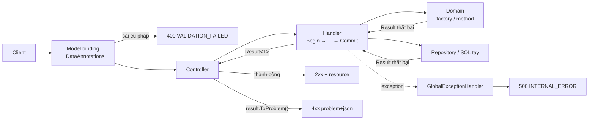

# Building blocks — khối nền dùng chung cho mọi module

Lớp 3 — Design.
ADR: [ADR-0016](../adr/0016-result-and-problem-details.md) (B1–B4),
[ADR-0017](../adr/0017-handler-per-use-case-no-mediator.md) (B6–B8).
Checklist dùng khi review: [`coding-conventions.md`](coding-conventions.md).

**Tài liệu này trả lời:** một request đi từ controller tới DB rồi quay về thì đi qua những "khuôn" nào,
và khuôn đó giống nhau ở cả 6 module.

---

## Tóm tắt quyết định

| # | Quyết định | Nằm ở đâu |
|---|---|---|
| B1 | Result pattern tự viết: `Result`, `Result<T>`, `Error`, `ErrorType` | `Shared.Abstractions/Results/` |
| B2 | Exception chỉ cho lỗi **không mong đợi**; unique violation đổi thành `Result` tại repository | quy ước |
| B3 | **Không** success envelope — 2xx trả thẳng resource; danh sách dùng `PagedResponse<T>` | `Shared.Abstractions/Results/` |
| B4 | Một lối ra lỗi: mọi lỗi là `application/problem+json` có `code`, `action`, `traceId` | `Shared.Infrastructure/Web/` |
| B5 | Validation hai tầng: cú pháp ở request DTO (400), luật nghiệp vụ trong domain (409/422) | module |
| B6 | Không mediator; mỗi use case một handler, gọi thẳng từ controller | module `Application/` |
| B7 | Handler điều khiển transaction **tường minh** (`BeginAsync` / `CommitAsync`) | module `Application/` |
| B8 | Repository theo aggregate, chỉ cho phía ghi EF Core; phía đọc chiếu thẳng ra DTO | module |
| B9 | Domain tối thiểu: aggregate `sealed`, factory trả `Result<T>`, value object là `record`, UUIDv7 | module `Domain/` |
| B10 | `TimeProvider` (built-in), không có `IClock` tự viết | DI ở host |
| B11 | Options pattern + `ValidateOnStart` cho mọi cấu hình | module / host |
| B12 | Code web dùng chung nằm ở `Shared.Infrastructure/Web/`, không tạo project thứ ba | `Shared.Infrastructure` |

---

## Đường đi của một request



Ba lối ra lỗi (400 tự động, `ToProblem()`, exception handler) **cùng một shape** vì cả ba đi qua
`ProblemDetailsFactory` / `IProblemDetailsService` đã được cấu hình một lần (B4).

---

## B1 — Result pattern

**Vấn đề.** Phần lớn "lỗi" trong hệ thống này là **kết quả dự đoán được** của nghiệp vụ: ghế đã có
người, email đã đăng ký, đơn đã hết hạn, quá 6 ghế. Chúng không phải bug. Người gọi **phải** xử lý
chúng, và client phải nhận `code` + `action` riêng cho từng cái (`FR-36`).

**Quyết định.** Kiểu trả về của mọi handler và mọi method domain có thể thất bại là `Result` /
`Result<T>`. Chữ ký (chỉ chữ ký, thân hàm do hiện thực quyết định):

```csharp
namespace TicketSystem.Shared.Abstractions.Results;

public enum ErrorType { Validation, Unauthorized, Forbidden, NotFound, Conflict, BusinessRule }

public sealed record Error(
    string Code,                                   // "EMAIL_TAKEN" — ổn định cho máy
    string Title,                                  // "Email đã được đăng ký" — cho người
    string Action,                                 // "Đăng nhập, hoặc dùng email khác." — FR-36
    ErrorType Type,
    IReadOnlyDictionary<string, object?>? Extensions = null); // vd unavailableSeatIds

public class Result
{
    public bool IsSuccess { get; }
    public bool IsFailure { get; }
    public Error Error { get; }                    // ném InvalidOperationException nếu IsSuccess
    public static Result Success();
    public static Result Failure(Error error);
    public static implicit operator Result(Error error);
}

public sealed class Result<T> : Result
{
    public T Value { get; }                        // ném InvalidOperationException nếu IsFailure
    public static Result<T> Success(T value);
    public static new Result<T> Failure(Error error);
    public static implicit operator Result<T>(T value);
    public static implicit operator Result<T>(Error error);
}
```

Lỗi của từng aggregate là **hằng số** trong module, cạnh aggregate đó — không bao giờ viết chuỗi
`code` rải rác:

```csharp
// TicketSystem.IdentityAccess/Domain/Users/UserErrors.cs
internal static class UserErrors
{
    public static readonly Error EmailTaken = new(
        "EMAIL_TAKEN", "Email đã được đăng ký", "Đăng nhập, hoặc dùng email khác.", ErrorType.Conflict);
    // InvalidCredentials, UserNotFound, CannotChangeOwnRole, ...
}
```

**Vì sao chọn:**

- **Chữ ký nói thật.** `Task<Result<UserResponse>> HandleAsync(...)` cho người đọc (và compiler) biết
  method này có thể thất bại theo cách nghiệp vụ. `Task<UserResponse>` + exception thì giấu điều đó.
- **Có chỗ cho `action` và trường thêm.** `api-contract.md` bắt mọi lỗi có `action`, và
  `SEATS_UNAVAILABLE` mang `unavailableSeatIds`. `Extensions` chứa phần thêm đó mà không cần một lớp
  exception riêng cho từng mã.
- **Rẻ.** Không tạo stack trace, không unwind — quan trọng ở luồng giữ ghế khi mở bán phim hot, nơi
  `409` là kết quả *bình thường* của hàng trăm request.
- **Nhỏ.** Khoảng 80 dòng — đọc hết, hiểu hết.

**Không chọn:**

- *Exception cho lỗi nghiệp vụ* (`throw new EmailTakenException()`): luồng điều khiển ẩn, dễ bị một
  `catch (Exception)` nuốt mất; chi phí stack trace ở hot path; không nhìn chữ ký là biết.
- *FluentResults / ErrorOr*: thêm package cho một thứ 80 dòng; không có sẵn khái niệm `action`; người
  học không thấy cơ chế bên trong.
- *`OneOf<T, Error1, Error2…>`*: chính xác hơn về kiểu nhưng chữ ký dài, mỗi lần thêm mã lỗi phải sửa
  mọi người gọi.

**Đặt ở `Shared.Abstractions`** — hợp luật D6: thuần kỹ thuật, không chứa thuật ngữ `GLOSSARY.md`,
mọi module cần ngay (luật 2). Các mã lỗi cụ thể thì **không** ở `Shared` — chúng là ngôn ngữ của module.

---

## B2 — Khi nào exception, khi nào `Result`

| Tình huống | Dùng | Kết quả HTTP |
|---|---|---|
| Yêu cầu sai luật / thế giới đã đổi (email trùng, ghế đã giữ, đơn hết hạn) | `Result` thất bại | 4xx theo `ErrorType` |
| Bug (null không ngờ, trạng thái không thể có), DB sập, timeout, Redis mất kết nối | exception, **không bắt** | 500 `INTERNAL_ERROR` |
| Client huỷ request (`OperationCanceledException` với token của request) | exception, không bắt | không ghi body; log mức `Information` |
| Unique violation (`SqlState 23505`) **mà nghiệp vụ dự đoán được** (email trùng do hai người đăng ký cùng lúc) | repository bắt `PostgresException` **theo tên constraint** rồi trả `Result` | 409 `EMAIL_TAKEN` |
| Unique violation không dự đoán | để exception đi lên | 500 — đó là bug |

**Mẫu "kiểm trước + constraint là chốt chặn":** handler kiểm `EmailExistsAsync` để trả lỗi đẹp trong
trường hợp thường; constraint `UNIQUE (email)` là thứ **thật sự** đảm bảo khi hai request đăng ký cùng
email chạy song song (cửa sổ race giữa kiểm và ghi). Repository đổi đúng **một** constraint đã biết
tên thành `UserErrors.EmailTaken`. Đây là cùng tinh thần với `concurrency.md`: điều kiện đúng đắn nằm ở
DB, code chỉ dịch kết quả.

**Không chọn:** bắt `DbUpdateException` chung ở middleware rồi đoán ra `409` — middleware không biết
constraint nào thuộc mã lỗi nào, và sẽ biến cả bug thành `409`.

**Luật cứng:** không có `catch (Exception)` trong module. Chỉ `GlobalExceptionHandler` (B4) bắt mọi thứ.

---

## B3 — Không có success envelope

**Quyết định.** Response thành công trả **thẳng** resource:

```http
HTTP/1.1 201 Created
Location: /api/auth/me
{ "id": "0193…", "email": "a@b.vn", "role": "Customer" }
```

Không bọc thành `{ "success": true, "data": {…}, "errors": null }`. Danh sách dùng shape đã chốt ở
`api-contract.md`:

```csharp
public sealed record PagedResponse<T>(IReadOnlyList<T> Items, int Page, int PageSize, int TotalCount);
```

**Vì sao chọn:**

- **HTTP status đã là "success flag".** Envelope lặp lại thông tin đó, và tạo khả năng hai nguồn mâu
  thuẫn (`200` + `"success": false` — đúng thứ `api-contract.md` cấm: "không có `200` cho lỗi nghiệp vụ").
- **Lỗi đã có chuẩn** (RFC 9457). Envelope tự chế nghĩa là hai định dạng lỗi song song.
- **Client đơn giản**: frontend, k6, test integration đọc thẳng body; không phải bóc vỏ.

**Không chọn:**

- *Envelope `{ success, data, error }`*: phổ biến ở codebase cũ / API nội bộ, nhưng trùng status, lệch
  hợp đồng đã chốt và không có lợi ích gì khi client là trình duyệt / k6.
- *Envelope chỉ cho danh sách* (`{ data: [...], meta: {...} }`): `PagedResponse<T>` đã là một object
  có tên trường rõ ràng — không cần thêm tầng.

---

## B4 — Một lối ra lỗi: `problem+json`

Shape đã chốt ở [`api-contract.md`](api-contract.md#định-dạng-lỗi--applicationproblemjson-rfc-9457).
Phần này chốt **cơ chế** để mọi lỗi ra đúng shape đó.

### Bảng `ErrorType → status`

| `ErrorType` | Status | Ví dụ `code` |
|---|---|---|
| `Validation` | `400` | `VALIDATION_FAILED`, `IDEMPOTENCY_KEY_REQUIRED` |
| `Unauthorized` | `401` | `INVALID_CREDENTIALS`, `REFRESH_TOKEN_REUSED` |
| `Forbidden` | `403` | `NOT_ASSIGNED` |
| `NotFound` | `404` | `USER_NOT_FOUND`, `MOVIE_NOT_FOUND` |
| `Conflict` | `409` | `EMAIL_TAKEN`, `SEATS_UNAVAILABLE` |
| `BusinessRule` | `422` | `CANNOT_CHANGE_OWN_ROLE`, `BOOKING_TOO_LARGE` |

`429` (rate limiter) và `503` (admission control) **không** đi qua `Result` — chúng do middleware sinh
ra trước khi vào controller. `OnRejected` của chúng gọi cùng `IProblemDetailsService` để ra cùng shape
(xem [`api-contract.md`](api-contract.md)).

### Bốn mảnh

| Mảnh | Cơ chế ASP.NET Core | Sinh ra |
|---|---|---|
| (a) `Result` thất bại | Extension `ToProblem(this Result, ControllerBase)` dùng `ProblemDetailsFactory` | 4xx có `code`, `action`, `Extensions` |
| (b) Exception chưa bắt | `GlobalExceptionHandler : IExceptionHandler` + `app.UseExceptionHandler()` | 500 `INTERNAL_ERROR`; log `Error` kèm exception; **không** có stack trace / message trong body |
| (c) Model binding / DataAnnotations sai | `ApiBehaviorOptions.InvalidModelStateResponseFactory` | 400 `VALIDATION_FAILED` + `errors: { field: [msg] }` |
| (d) Mọi response lỗi | `AddProblemDetails(o => o.CustomizeProblemDetails = …)` | gắn `traceId` (`Activity.Current?.Id ?? HttpContext.TraceIdentifier`); `type` = `https://errors.ticket.local/<code-kebab>` |
| (e) 401/403/404 rỗng (auth, route không tồn tại) | `app.UseStatusCodePages()` (sau `AddProblemDetails` tự sinh problem+json) | status đúng, có `traceId` |

Đăng ký một chỗ: `services.AddApiErrorHandling()` + `app.UseApiErrorHandling()` trong
`Shared.Infrastructure/Web/`. `Program.cs` chỉ gọi hai dòng đó.

Controller trông như sau (chỉ là hình dạng):

```csharp
[HttpPost("register")]
public async Task<IActionResult> Register(RegisterRequest request, CancellationToken ct)
{
    var result = await handler.HandleAsync(new RegisterUserCommand(request.Email, request.Password), ct);
    return result.IsSuccess
        ? CreatedAtAction(nameof(Me), result.Value)
        : result.ToProblem(this);
}
```

**Vì sao chọn:**

- **Built-in, đã có sẵn từ .NET 8.** `IExceptionHandler`, `AddProblemDetails`, `IProblemDetailsService`
  là cơ chế chính thức; không viết lại middleware try/catch.
- **`traceId` ở mọi lỗi** — người dùng chụp màn hình lỗi, ta tìm được log (nối với log và trace ở phần observability).
- **Không lộ nội tạng ở 500.** Message exception có thể chứa câu SQL, tên bảng, connection string.

**Không chọn:**

- *Middleware try/catch tự viết*: trùng chức năng `IExceptionHandler`, phải tự lo response đã bắt đầu
  ghi, tự lo content negotiation.
- *Exception filter của MVC*: chỉ bắt lỗi trong action; lỗi ở middleware (auth, rate limiter) lọt ra ngoài.
- *Map exception → status* (`NotFoundException` → 404): quay lại dùng exception cho luồng nghiệp vụ (B1).

---

## B5 — Validation hai tầng

| Tầng | Kiểm cái gì | Ở đâu | Lỗi |
|---|---|---|---|
| Cú pháp | Thiếu trường, sai kiểu, sai định dạng email, password < 10 ký tự, `pageSize > 100` | DataAnnotations trên **request DTO** ở `Api/Requests/` (`[Required]`, `[EmailAddress]`, `[MinLength(10)]`, `[Range]`) — `[ApiController]` tự trả 400 | `400 VALIDATION_FAILED` |
| Nghiệp vụ | Quá 6 ghế, suất đã bắt đầu, đổi vai trò của chính mình, email trùng | Domain (factory / method của aggregate) hoặc handler khi cần dữ liệu từ DB | `409` / `422` qua `Result` |

Phép thử để biết một luật thuộc tầng nào: **"luật này có cần đọc DB hoặc biết trạng thái hiện tại không?"**
Không ⇒ cú pháp (hoặc invariant của value object). Có ⇒ nghiệp vụ. Đúng ranh giới `400` vs `422` /
`409` của `api-contract.md`.

Value object vẫn tự bảo vệ: `Email.Create(string)` trả `Result<Email>` (chuẩn hoá chữ thường, kiểm
định dạng) — để domain không bao giờ tin vào việc controller đã validate.

**Không chọn:**

- *FluentValidation*: thêm package; rule viết trong validator class dễ kéo luật nghiệp vụ (cần DB)
  ra khỏi domain; với số lượng request DTO của dự án, DataAnnotations đủ.
- *Validate tay trong controller*: lặp lại, dễ quên, không ra shape `errors` thống nhất.

---

## B6 — Use case: mỗi lệnh một handler, không mediator

**Quyết định** (mediator bên trong module — câu để mở ở `architecture.md` D4):

```csharp
// Application/Register/RegisterUserCommand.cs
internal sealed record RegisterUserCommand(string Email, string Password);

// Application/Register/RegisterUserHandler.cs
internal sealed class RegisterUserHandler(
    IUnitOfWork uow, IUserRepository users, IPasswordHasher<User> hasher, TimeProvider clock)
{
    public Task<Result<UserResponse>> HandleAsync(RegisterUserCommand command, CancellationToken ct);
}
```

- Đăng ký thẳng trong `<Module>Module.cs`: `services.AddScoped<RegisterUserHandler>();`
- Controller inject handler qua constructor (primary constructor).
- Query (đọc) cũng là handler: `GetCurrentUserHandler`, `ListUsersHandler`.

**Vì sao chọn:**

- **F12 đi thẳng tới code chạy.** Đọc controller là biết handler nào chạy; không phải tìm "ai xử lý
  `RegisterUserCommand`".
- **Nhất quán với ADR-0009**: giữa module đã bỏ mediator vì nó che hướng phụ thuộc. Trong module, lợi
  ích còn lại của mediator là pipeline behavior — nhưng cross-cutting duy nhất đang có (transaction)
  lại **không** được làm tự động (B7).
- **MediatR đổi sang license thương mại** từ v13 (2025) — dự án CV public nên tránh phụ thuộc vào điều
  khoản license.

**Không chọn:**

- *MediatR + `IPipelineBehavior`*: ma thuật với người mới; license.
- *Generic `ICommandHandler<TCommand, TResult>` + decorator (Scrutor)*: trừu tượng thêm khi chưa có
  cross-cutting thứ hai cần nó. Nếu sau này cần (ví dụ log/metric mỗi use case) thì thêm lúc đó,
  kèm ADR thay thế.

---

## B7 — Ai mở và commit transaction

**Quyết định.** **Handler**, tường minh:

```text
HandleAsync:
  1. kiểm tra rẻ không cần DB (nếu có)
  2. await uow.BeginAsync(ct)
  3. đọc / gọi domain / ghi qua repository hoặc SQL tay
  4. nếu thất bại nghiệp vụ → return error        (không Commit ⇒ DisposeAsync rollback)
  5. await uow.CommitAsync(ct)
  6. return value
```

Query handler cũng gọi `BeginAsync` (interceptor cấm `DbContext` mở connection ngoài Unit of
Work); không commit thì rollback — với transaction chỉ đọc, rollback và commit tương đương.

**Vì sao chọn:**

- **ADR-0011 cần commit cả khi nghiệp vụ thất bại**: giữ ghế thất bại vẫn phải commit bản ghi
  idempotency chứa kết quả `409` (sau `ROLLBACK TO SAVEPOINT`). Một filter tự động "commit khi
  `Result.IsSuccess`" sẽ làm **sai** đúng luồng quan trọng nhất của dự án.
- **Ranh giới transaction là thứ phải review được** ở mọi bài concurrency (`concurrency.md`). Nó phải
  nằm trong code của use case, không nằm trong một attribute ở chỗ khác.
- **Rollback đã an toàn**: `NpgsqlUnitOfWork.DisposeAsync` rollback mọi transaction chưa commit (có test). Handler quên commit ⇒ test đỏ ngay, không mất dữ liệu âm thầm.

**Không chọn:**

- *Middleware / action filter mở-commit theo request*: che ranh giới; sai với ADR-0011; mở transaction
  cả cho request không cần DB.
- *`[Transactional]` attribute*: như trên, thêm ma thuật.

---

## B8 — Repository: theo aggregate, chỉ phía ghi

| Loại thao tác | Dùng | Ví dụ |
|---|---|---|
| Ghi aggregate ít tranh chấp (EF Core — D7) | **Repository** theo aggregate root | `IUserRepository.GetByIdAsync`, `GetByEmailAsync`, `Add` |
| Đọc ra DTO | **Query handler** dùng thẳng `DbContext` (`AsNoTracking` + `Select`) hoặc Dapper | `GetCurrentUserHandler`, `ListUsersHandler` |
| Hot path tranh chấp (D7) | **Class SQL tay** đặt tên theo việc, không gọi là repository | `SeatHoldSql`, `QuotaLock` |

Quy tắc của repository:

- Interface ở `Application/Abstractions/`, hiện thực `internal sealed` ở `Infrastructure/Repositories/`.
- Một repository cho **một aggregate root**, load / lưu **cả** aggregate. Không có `IBookingLineRepository`.
- Method mang tên nghiệp vụ; **không** trả `IQueryable`, không `GetAll()`, không `Update(entity)` (change
  tracking của EF đã theo dõi).
- Repository **sở hữu** `SaveChangesAsync(ct)` và trả `Task<Result>` — vì `23505` chỉ lộ ra lúc
  `SaveChanges`, và repository là chỗ biết constraint nào ứng với mã lỗi nào (B2). Handler gọi
  `await users.SaveChangesAsync(ct)` rồi mới `await uow.CommitAsync(ct)`. Phân biệt hai việc:
  `SaveChanges` chỉ **đẩy SQL** vào transaction đang mở; **commit** duy nhất ở `IUnitOfWork` (B7).

**Vì sao chọn:**

- **Repository = ranh giới aggregate.** Nó là chỗ duy nhất biết cách dựng lại một aggregate từ bảng,
  nên handler không lỡ tay sửa nửa aggregate.
- **CQRS-lite**: đọc không cần dựng aggregate rồi map ngược ra DTO — chiếu thẳng rẻ hơn và rõ hơn.
- **Khớp D7**: một hot path một tầng; repository EF không bao giờ chen vào luồng giữ ghế.
- **Là chỗ dịch lỗi constraint** (B2).

**Không chọn:**

- *Generic `IRepository<T>` (CRUD)*: CRUD không khớp aggregate (có `Delete(BookingLine)`?); lộ
  `IQueryable` ⇒ query bằng LINQ rải khắp handler; EF Core đã là repository + unit of work, bọc thêm một
  lớp generic không thêm gì.
- *Bỏ hẳn repository, handler dùng thẳng `DbContext`*: chạy được (nhiều team làm vậy), nhưng ranh giới
  aggregate chỉ còn là kỷ luật, và mẫu dịch `23505` lặp ở mọi handler.

---

## B9 — Domain building blocks tối thiểu

| Khối | Quy ước | Ví dụ |
|---|---|---|
| Aggregate root | `internal sealed class`; setter `private`; constructor `private` (thêm constructor rỗng `private` cho EF); tạo bằng factory tĩnh trả `Result<T>`; đổi trạng thái bằng method có tên nghiệp vụ trả `Result` | `User.Register(email, passwordHash, now)`, `user.ChangeRole(newRole, changedBy, now)` |
| Value object | `sealed record` hoặc `readonly record struct`; tạo qua `Create` trả `Result<T>`; bất biến | `Email` |
| Id | `Guid.CreateVersion7()` (UUIDv7 — xem [`data-model.md`](data-model.md)); strongly-typed `readonly record struct UserId(Guid Value)` **chỉ khi** id đi qua `.Contracts` sang module khác | `UserId` ở `IdentityAccess.Contracts` (R8) |
| Enum trạng thái | C# `enum`, lưu DB dạng `text` (`HasConversion<string>()`) khớp `CHECK` ở [`data-model.md`](data-model.md) | `Role` |
| Thời gian | luôn nhận `DateTimeOffset now` từ ngoài vào (handler lấy từ `TimeProvider`) — domain không tự đọc đồng hồ | |

**Không** tạo base class `Entity<TId>` / `AggregateRoot` / `ValueObject` ở `Shared` bây giờ: luật 2 của
D6 ("chỉ thêm khi ≥ 2 module cần ngay"), và `record` đã cho value equality miễn phí. Domain event bên
trong aggregate cũng chưa cần — event giữa module dùng cơ chế D4 (handler publish tường minh).

**Không chọn:** *Anemic model* (entity chỉ có property public set, logic ở handler) — invariant khi đó
được bảo vệ bởi việc "nhớ gọi đúng thứ tự", không phải bởi compiler.

---

## B10 — `TimeProvider`

Dùng **`System.TimeProvider`** (built-in từ .NET 8), đăng ký `services.AddSingleton(TimeProvider.System)` ở
host; test dùng `FakeTimeProvider` (`Microsoft.Extensions.TimeProvider.Testing`) để tua giờ (hết hạn giữ
ghế 15 phút, refresh token 14 ngày).

**Không chọn** `IClock` tự viết: trùng chức năng với kiểu chuẩn của nền tảng; thư viện bên ngoài (rate
limiter, cache) đã hiểu `TimeProvider`.

> Thời điểm **trong transaction** vẫn ưu tiên `now()` của Postgres khi điều kiện nằm trong SQL
> (`expires_at > now()` — `concurrency.md`). `TimeProvider` dùng cho logic ở C#.

---

## B11 — Cấu hình: Options pattern + kiểm khi khởi động

```csharp
services.AddOptions<JwtOptions>()
    .BindConfiguration(JwtOptions.SectionName)
    .ValidateDataAnnotations()
    .ValidateOnStart();
```

Mỗi nhóm cấu hình một class `sealed` có `SectionName` và DataAnnotations (`[Required]`, `[MinLength(32)]`
cho khoá ký). Secret vẫn đến từ `user-secrets` / biến môi trường không vào `appsettings.json`.

**Vì sao:** cấu hình sai ⇒ app **không khởi động** (fail fast), thay vì request đầu tiên trả 500.
**Không chọn:** `configuration["Jwt:Key"]` rải rác — không kiểm, không có kiểu, khó tìm.

---

## B12 — Đặt code dùng chung ở đâu

| Thành phần | Project | Vì sao |
|---|---|---|
| `Result`, `Result<T>`, `Error`, `ErrorType`, `PagedResponse<T>` | `Shared.Abstractions/Results/` | Không phụ thuộc gì; domain và `.Contracts` dùng được |
| `ResultHttpExtensions.ToProblem`, `GlobalExceptionHandler`, `ApiErrorHandlingExtensions` (`AddApiErrorHandling` / `UseApiErrorHandling`) | `Shared.Infrastructure/Web/` (thêm `<FrameworkReference Include="Microsoft.AspNetCore.App" />`) | Controller nằm trong module (D2) nên module phải gọi được `ToProblem`; `Shared.Infrastructure` đã là thứ module nội bộ + host reference |

Arch test hiện có (`Rule2_Shared_Abstractions_has_no_infrastructure_dependencies`) tiếp tục giữ
`Shared.Abstractions` sạch ASP.NET Core.

**Không chọn:**

- *Project `Shared.Web` thứ ba*: thêm một cạnh phụ thuộc và một ngoại lệ trong arch test cho ~3 file;
  D6 giữ "hai project".
- *Đặt ở Host*: module không reference Host ⇒ controller không gọi được `ToProblem`.

---

## Cấu trúc thư mục bên trong một module

Bổ sung cho cây ở `architecture.md` D2. Ví dụ `IdentityAccess`:

```
TicketSystem.IdentityAccess/
  Domain/
    Users/
      User.cs                 aggregate root
      Email.cs                value object
      Role.cs                 enum
      UserErrors.cs           mã lỗi của aggregate (code, title, action)
    RefreshTokens/ ...
  Application/
    Abstractions/
      IUserRepository.cs
    Register/
      RegisterUserCommand.cs
      RegisterUserHandler.cs
    Login/ ...
    GetCurrentUser/ ...        query handler
  Infrastructure/
    IdentityDbContext.cs
    Configurations/UserConfiguration.cs   IEntityTypeConfiguration<User>
    Repositories/UserRepository.cs
    Migrations/
  Api/
    AuthController.cs
    Requests/RegisterRequest.cs           DataAnnotations (B5)
    Responses/UserResponse.cs
  IdentityAccessModule.cs                 AddIdentityAccessModule(...) — đăng ký handler, repo, DbContext, options
```

**Hiển thị:** mọi type trong project nội bộ là `internal` (và `sealed` nếu không thiết kế để kế thừa),
**trừ** `<Module>Module` và controller (`public` để MVC tìm thấy). Project test của module được thấy
`internal` qua `<InternalsVisibleTo Include="TicketSystem.<Module>.Tests" />` trong `.csproj`.
Kiểm bằng architecture test.

**Ba loại DTO, không dùng lẫn:**

| DTO | Ở đâu | Ai thấy |
|---|---|---|
| Request / Response của HTTP | `Api/Requests`, `Api/Responses` | client — đổi = đổi `api-contract.md` |
| DTO của `.Contracts` | `TicketSystem.<Module>.Contracts` | module khác — đổi = đổi hợp đồng giữa module |
| Entity / value object | `Domain/` | chỉ module đó — đổi tự do |

Trả thẳng entity ra HTTP là lỗi review: lộ `password_hash`, khoá API vào schema DB.

---

## Ví dụ xuyên suốt — `POST /api/auth/register`

| Bước | Ở đâu | Building block |
|---|---|---|
| 1. `{ email, password }` thiếu / sai định dạng / password 9 ký tự | `RegisterRequest` + `[ApiController]` | B5 → B4(c): `400 VALIDATION_FAILED` |
| 2. Controller gọi `RegisterUserHandler.HandleAsync` | `AuthController` | B6 |
| 3. `Email.Create` chuẩn hoá chữ thường | `Domain/Users/Email.cs` | B9 |
| 4. `BeginAsync` | handler | B7 |
| 5. `users.EmailExistsAsync` → có ⇒ `return UserErrors.EmailTaken` (không commit ⇒ rollback) | handler + repository | B1, B8 |
| 6. Hash password, `User.Register(...)` với `Guid.CreateVersion7()`, `clock.GetUtcNow()` | domain | B9, B10 |
| 7. `users.Add(user)`; `users.SaveChangesAsync` — nếu race làm `23505` trên constraint unique của `email` ⇒ repository trả `EmailTaken` | repository | B2 |
| 8. `CommitAsync`, trả `UserResponse` | handler | B7 |
| 9. `201` + body thẳng, hoặc `result.ToProblem(this)` ⇒ `409 EMAIL_TAKEN` có `action`, `traceId` | controller | B3, B4(a) |
| — Postgres sập giữa chừng | — | B4(b): `500 INTERNAL_ERROR`, log có exception, body không có chi tiết |
