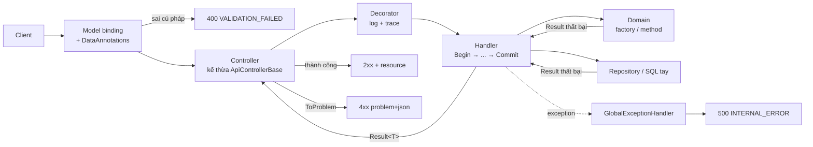

# Building blocks — khối nền dùng chung cho mọi module

Lớp 3 — Design.
ADR: [ADR-0016](../adr/0016-result-and-problem-details.md) (B1–B4),
[ADR-0017](../adr/0017-handler-per-use-case-no-mediator.md) (B6–B8, một phần),
[ADR-0018](../adr/0018-domain-and-application-primitives.md) (B6, B9, B13 — đổi một phần ADR-0017).
Checklist dùng khi review: [`coding-conventions.md`](coding-conventions.md).

**Tài liệu này trả lời:** một request đi từ controller tới DB rồi quay về thì đi qua những "khuôn" nào,
khuôn đó giống nhau ở cả 6 module, và nền móng nào phải có **trước** khi viết module đầu tiên (M0).

**Luật trình bày:** tài liệu mô tả *ý định, luật, lý do, phương án bị loại*. Hình dạng chính xác (chữ ký,
SQL, cấu hình) sống trong code và test — docs không chứa khối code. Tên type, member, mã lỗi trong
backtick là thuật ngữ, không phải code.

---

## Tóm tắt quyết định

| # | Quyết định | Nằm ở đâu |
|---|---|---|
| B1 | Result pattern tự viết: `Result`, `Result<T>`, `Error`, `ErrorType` | `Shared.Abstractions/Results/` |
| B2 | Exception chỉ cho lỗi **không mong đợi**; unique violation đổi thành `Result` tại repository | quy ước |
| B3 | **Không** success envelope — 2xx trả thẳng resource; danh sách dùng `PagedResponse<T>` | `Shared.Abstractions/Results/` |
| B4 | Một lối ra lỗi: mọi lỗi là `application/problem+json` có `code`, `action`, `traceId` | `Shared.Infrastructure/Web/` |
| B5 | Validation hai tầng: cú pháp ở request DTO (400), luật nghiệp vụ trong domain (409/422) | module |
| B6 | Handler hiện thực `ICommandHandler` / `IQueryHandler`; quét assembly để đăng ký; một decorator log + trace; **không** mediator | `Shared.Abstractions/Application/`, module `Application/` |
| B7 | Handler điều khiển transaction **tường minh** (`BeginAsync` / `CommitAsync`) | module `Application/` |
| B8 | Repository chỉ cho `AggregateRoot`, phía ghi EF Core; phía đọc chiếu thẳng ra DTO | module |
| B9 | Domain primitives có base class: `Entity<TId>`, `AggregateRoot<TId>`, `ValueObject`, typed id | `Shared.Abstractions/Domain/` |
| B10 | `TimeProvider` (built-in), không có `IClock` tự viết | DI ở host |
| B11 | Options pattern + `ValidateOnStart` cho mọi cấu hình | module / host |
| B12 | Bản đồ: code dùng chung nằm ở project nào, không tạo project thứ ba | `Shared.*` |
| B13 | Domain event + bus in-process: aggregate gom event, handler publish tường minh trước commit | `Shared.Abstractions`, `Shared.Infrastructure` |
| B14 | Persistence foundation: `ModuleDbContext`, quy ước EF, migration, Dapper type handler | `Shared.Infrastructure/Persistence/` |
| B15 | Web foundation: JSON options, `ApiControllerBase`, OpenAPI | `Shared.Infrastructure/Web/` + host |
| B16 | Auth foundation: JWT bearer, policy vai trò, `ICurrentUser`, contract vai trò | `Shared.Infrastructure/Web/` + `IdentityAccess.Contracts` |
| B17 | Observability foundation: Serilog JSON, correlation ID, health live/ready | `Shared.Infrastructure` + host |
| B18 | Test foundation: `TicketSystem.Testing`, project test mỗi module, arch test mở rộng | `tests/` |
| B19 | Tooling và CI: analyzer, format check, coverage, Mailpit, script | `backend/`, `scripts/`, `.github/` |

---

## Đường đi của một request



Ba lối ra lỗi (400 tự động, `ToProblem`, exception handler) **cùng một shape** vì cả ba đi qua
`ProblemDetailsFactory` / `IProblemDetailsService` đã được cấu hình một lần (B4).

---

## B1 — Result pattern

**Vấn đề.** Phần lớn "lỗi" trong hệ thống này là **kết quả dự đoán được** của nghiệp vụ: ghế đã có
người, email đã đăng ký, đơn đã hết hạn, quá 6 ghế. Chúng không phải bug. Người gọi **phải** xử lý
chúng, và client phải nhận `code` + `action` riêng cho từng cái (`FR-36`).

**Quyết định.** Kiểu trả về của mọi handler và mọi method domain có thể thất bại là `Result` /
`Result<T>`.

| Thành phần | Trách nhiệm | Luật |
|---|---|---|
| `ErrorType` | Phân loại lỗi để map sang status (bảng ở B4) | Sáu giá trị: `Validation`, `Unauthorized`, `Forbidden`, `NotFound`, `Conflict`, `BusinessRule` |
| `Error` | Một lỗi có tên: `Code` (ổn định, cho máy), `Title` (cho người), `Action` (gợi ý hành động — `FR-36`), `Type`, `Extensions` (trường thêm, vd `unavailableSeatIds`) | Bất biến; `Code`, `Title`, `Action` không rỗng |
| `Result` | Kết quả không mang giá trị: `IsSuccess` / `IsFailure`, `Error`, factory `Success` / `Failure` | Đọc `Error` khi thành công ⇒ `InvalidOperationException` (bug, không phải luồng nghiệp vụ) |
| `Result<T>` | Kết quả mang giá trị `Value` | Đọc `Value` khi thất bại ⇒ `InvalidOperationException`; cho phép chuyển ngầm từ `T` và từ `Error` để thân hàm gọn |

Lỗi của từng aggregate là **hằng số** trong module, cạnh aggregate đó, theo mẫu `<Aggregate>Errors`
(vd `UserErrors.EmailTaken`, `UserErrors.InvalidCredentials`) — không bao giờ viết chuỗi `code` rải rác.
Bảng `code` hợp lệ nằm ở [`api-contract.md`](api-contract.md); chúng là ngôn ngữ của module, **không** ở `Shared`.

**Vì sao chọn:**

- **Chữ ký nói thật.** Handler trả `Result<UserResponse>` cho người đọc (và compiler) biết method này
  có thể thất bại theo cách nghiệp vụ. Trả thẳng `UserResponse` + exception thì giấu điều đó.
- **Có chỗ cho `action` và trường thêm.** `api-contract.md` bắt mọi lỗi có `action`, và
  `SEATS_UNAVAILABLE` mang `unavailableSeatIds`. `Extensions` chứa phần thêm đó mà không cần một lớp
  exception riêng cho từng mã.
- **Rẻ.** Không tạo stack trace, không unwind — quan trọng ở luồng giữ ghế khi mở bán phim hot, nơi
  `409` là kết quả *bình thường* của hàng trăm request.
- **Nhỏ.** Khoảng 80 dòng — đọc hết, hiểu hết.

**Không chọn:**

- *Exception cho lỗi nghiệp vụ* (`EmailTakenException`): luồng điều khiển ẩn, dễ bị một
  `catch (Exception)` nuốt mất; chi phí stack trace ở hot path; không nhìn chữ ký là biết.
- *FluentResults / ErrorOr*: thêm package cho một thứ 80 dòng; không có sẵn khái niệm `action`; người
  học không thấy cơ chế bên trong.
- *`OneOf<T, Error1, Error2…>`*: chính xác hơn về kiểu nhưng chữ ký dài, mỗi lần thêm mã lỗi phải sửa
  mọi người gọi.

**Đặt ở `Shared.Abstractions`** — hợp luật D6: thuần kỹ thuật, không chứa thuật ngữ `GLOSSARY.md`,
mọi module cần ngay (luật 2).

---

## B2 — Khi nào exception, khi nào `Result`

| Tình huống | Dùng | Kết quả HTTP |
|---|---|---|
| Yêu cầu sai luật / thế giới đã đổi (email trùng, ghế đã giữ, đơn hết hạn) | `Result` thất bại | 4xx theo `ErrorType` |
| Bug (null không ngờ, trạng thái không thể có), DB sập, timeout, Redis mất kết nối | exception, **không bắt** | 500 `INTERNAL_ERROR` |
| Client huỷ request (`OperationCanceledException` với token của request) | exception, không bắt | không ghi body; log mức `Information` |
| Unique violation (`SqlState 23505`) **mà nghiệp vụ dự đoán được** (email trùng do hai người đăng ký cùng lúc) | repository bắt `PostgresException` **theo tên constraint** rồi trả `Result` | 409 `EMAIL_TAKEN` |
| Unique violation không dự đoán | để exception đi lên | 500 — đó là bug |

**Mẫu "kiểm trước + constraint là chốt chặn":** handler kiểm `EmailExistsAsync` để trả lỗi đẹp trong
trường hợp thường; constraint `UNIQUE (email)` là thứ **thật sự** đảm bảo khi hai request đăng ký cùng
email chạy song song (cửa sổ race giữa kiểm và ghi). Repository đổi đúng **một** constraint đã biết
tên thành `UserErrors.EmailTaken`. Đây là cùng tinh thần với `concurrency.md`: điều kiện đúng đắn nằm ở
DB, code chỉ dịch kết quả.

**Không chọn:** bắt `DbUpdateException` chung ở middleware rồi đoán ra `409` — middleware không biết
constraint nào thuộc mã lỗi nào, và sẽ biến cả bug thành `409`.

**Luật cứng:** không có `catch (Exception)` trong module. Chỉ `GlobalExceptionHandler` (B4) bắt mọi thứ.

---

## B3 — Không có success envelope

**Quyết định.** Response thành công trả **thẳng** resource: `201 Created` kèm header `Location` và body là
chính resource (vd `id`, `email`, `role` của người dùng vừa tạo). Không bọc thành vỏ có cờ `success`,
`data`, `errors`.

Danh sách dùng `PagedResponse<T>`:

| Trường | Kiểu | Ý nghĩa |
|---|---|---|
| `Items` | danh sách `T` | Các phần tử của trang hiện tại |
| `Page` | số nguyên | Số trang, bắt đầu từ 1 |
| `PageSize` | số nguyên | Kích thước trang (tối đa 100 — xem `api-contract.md`) |
| `TotalCount` | số nguyên | Tổng số phần tử khớp bộ lọc |

**Vì sao chọn:**

- **HTTP status đã là "success flag".** Envelope lặp lại thông tin đó, và tạo khả năng hai nguồn mâu
  thuẫn (`200` kèm cờ thất bại — đúng thứ `api-contract.md` cấm: "không có `200` cho lỗi nghiệp vụ").
- **Lỗi đã có chuẩn** (RFC 9457). Envelope tự chế nghĩa là hai định dạng lỗi song song.
- **Client đơn giản**: frontend, k6, test integration đọc thẳng body; không phải bóc vỏ.

**Không chọn:**

- *Envelope `{ success, data, error }`*: phổ biến ở codebase cũ / API nội bộ, nhưng trùng status, lệch
  hợp đồng đã chốt và không có lợi ích gì khi client là trình duyệt / k6.
- *Envelope chỉ cho danh sách*: `PagedResponse<T>` đã là một object có tên trường rõ ràng — không cần thêm tầng.

---

## B4 — Một lối ra lỗi: `problem+json`

Shape đã chốt ở [`api-contract.md`](api-contract.md#định-dạng-lỗi--applicationproblemjson-rfc-9457).
Phần này chốt **cơ chế** để mọi lỗi ra đúng shape đó.

### Bảng `ErrorType → status`

| `ErrorType` | Status | Ví dụ `code` |
|---|---|---|
| `Validation` | `400` | `VALIDATION_FAILED`, `IDEMPOTENCY_KEY_REQUIRED` |
| `Unauthorized` | `401` | `INVALID_CREDENTIALS`, `REFRESH_TOKEN_REUSED` |
| `Forbidden` | `403` | `NOT_ASSIGNED` |
| `NotFound` | `404` | `USER_NOT_FOUND`, `MOVIE_NOT_FOUND` |
| `Conflict` | `409` | `EMAIL_TAKEN`, `SEATS_UNAVAILABLE` |
| `BusinessRule` | `422` | `CANNOT_CHANGE_OWN_ROLE`, `BOOKING_TOO_LARGE` |

`429` (rate limiter) và `503` (admission control) **không** đi qua `Result` — chúng do middleware sinh
ra trước khi vào controller. `OnRejected` của chúng gọi cùng `IProblemDetailsService` để ra cùng shape
(xem [`api-contract.md`](api-contract.md)).

### Các mảnh

| Mảnh | Cơ chế ASP.NET Core | Sinh ra |
|---|---|---|
| (a) `Result` thất bại | Extension `ToProblem` trên `Result` (gọi từ `ApiControllerBase`, B15) dùng `ProblemDetailsFactory` | 4xx có `code`, `action`, `Extensions` |
| (b) Exception chưa bắt | `GlobalExceptionHandler` (hiện thực `IExceptionHandler`) + `UseExceptionHandler` | 500 `INTERNAL_ERROR`; log `Error` kèm exception; **không** có stack trace / message trong body |
| (c) Model binding / DataAnnotations sai | `ApiBehaviorOptions.InvalidModelStateResponseFactory` | 400 `VALIDATION_FAILED` + `errors` (map tên trường → danh sách thông báo) |
| (d) Mọi response lỗi | `AddProblemDetails` với `CustomizeProblemDetails` | gắn `traceId` (lấy từ `Activity.Current`, rơi về `TraceIdentifier`); `type` = địa chỉ ổn định theo `code` dạng kebab-case |
| (e) 401/403/404 rỗng (auth, route không tồn tại) | `UseStatusCodePages` (sau `AddProblemDetails` tự sinh problem+json) | status đúng, có `traceId` |

Đăng ký một chỗ: cặp extension `AddApiErrorHandling` (services) và `UseApiErrorHandling` (pipeline) ở
`Shared.Infrastructure/Web/`. `Program.cs` chỉ gọi hai dòng đó.

**Vì sao chọn:**

- **Built-in, đã có sẵn từ .NET 8.** `IExceptionHandler`, `AddProblemDetails`, `IProblemDetailsService`
  là cơ chế chính thức; không viết lại middleware try/catch.
- **`traceId` ở mọi lỗi** — người dùng chụp màn hình lỗi, ta tìm được log (nối với B17).
- **Không lộ nội tạng ở 500.** Message exception có thể chứa câu SQL, tên bảng, connection string.

**Không chọn:**

- *Middleware try/catch tự viết*: trùng chức năng `IExceptionHandler`, phải tự lo response đã bắt đầu
  ghi, tự lo content negotiation.
- *Exception filter của MVC*: chỉ bắt lỗi trong action; lỗi ở middleware (auth, rate limiter) lọt ra ngoài.
- *Map exception → status* (`NotFoundException` → 404): quay lại dùng exception cho luồng nghiệp vụ (B1).

---

## B5 — Validation hai tầng

| Tầng | Kiểm cái gì | Ở đâu | Lỗi |
|---|---|---|---|
| Cú pháp | Thiếu trường, sai kiểu, sai định dạng email, password < 10 ký tự, `pageSize > 100` | DataAnnotations trên **request DTO** ở `Api/Requests/` (`[Required]`, `[EmailAddress]`, `[MinLength]`, `[Range]`) — `[ApiController]` (qua `ApiControllerBase`) tự trả 400 | `400 VALIDATION_FAILED` |
| Nghiệp vụ | Quá 6 ghế, suất đã bắt đầu, đổi vai trò của chính mình, email trùng | Domain (factory / method của aggregate) hoặc handler khi cần dữ liệu từ DB | `409` / `422` qua `Result` |

Phép thử để biết một luật thuộc tầng nào: **"luật này có cần đọc DB hoặc biết trạng thái hiện tại không?"**
Không ⇒ cú pháp (hoặc invariant của value object). Có ⇒ nghiệp vụ. Đúng ranh giới `400` vs `422` /
`409` của `api-contract.md`.

Value object vẫn tự bảo vệ: factory `Email.Create` trả `Result<Email>` (chuẩn hoá chữ thường, kiểm định
dạng) — để domain không bao giờ tin vào việc controller đã validate.

**Không chọn:**

- *FluentValidation*: thêm package; rule viết trong validator class dễ kéo luật nghiệp vụ (cần DB)
  ra khỏi domain; với số lượng request DTO của dự án, DataAnnotations đủ.
- *Validate tay trong controller*: lặp lại, dễ quên, không ra shape `errors` thống nhất.

---

## B6 — Use case: handler theo interface, quét đăng ký, decorator; không mediator

**Quyết định.** Mỗi use case là một cặp *input + handler*; handler hiện thực interface chung của
`Shared.Abstractions/Application/`. Đây là phần ADR-0018 đổi so với ADR-0017 (trước đó handler là class trần
không interface).

| Thành phần | Trách nhiệm | Luật |
|---|---|---|
| `ICommand<TResult>` / `IQuery<TResult>` | Marker cho input của use case (lệnh đổi trạng thái / truy vấn chỉ đọc) | Input là `record` bất biến, tên theo quy ước C-nn mục "Đặt tên" |
| `ICommandHandler<TCommand, TResult>` / `IQueryHandler<TQuery, TResult>` | Một handler một use case; method `HandleAsync(input, ct)` trả `Result<TResult>` | Một class một use case; class `internal sealed` |
| Quét assembly | `Add<Module>Module` quét assembly của module, đăng ký mọi handler (Scoped) | Một dòng, không quên đăng ký; handler mới tự được đăng ký |
| Decorator dùng chung | Bọc mọi handler: log bắt đầu / kết thúc + thời gian + kết quả (`code` khi thất bại) và tạo `Activity` cho trace | Chỉ cross-cutting quan sát; **không** mở / commit transaction; M3 gắn metric vào đây |
| Controller | Inject **đúng interface của handler** cần dùng (vd `ICommandHandler<RegisterUserCommand, UserResponse>`) | F12 / "Go to implementation" vẫn tới thẳng class; controller không chứa `if` nghiệp vụ |

Truy vấn đọc cũng là handler (`IQueryHandler`): lấy người dùng hiện tại, liệt kê người dùng.

**Vì sao chọn:**

- **Một khuôn cho 6 module.** Người học đọc một handler là biết mọi handler còn lại có hình dạng gì.
- **Có chỗ để gắn cross-cutting đúng một lần.** Log, trace, về sau metric (M3) viết một decorator thay vì
  chép vào từng handler. Đây đúng là điều kiện "xem lại khi" mà ADR-0017 đã ghi: nay có code gọi handler
  một cách tổng quát.
- **Quét assembly** thay đăng ký thủ công từng handler: không có lỗi "quên `AddScoped`" chỉ lộ lúc chạy.
- **F12 vẫn đi thẳng tới code chạy**: controller phụ thuộc interface *cụ thể theo kiểu input*, nên chỉ có
  một hiện thực — khác mediator, nơi người gọi chỉ biết "gửi lệnh".
- **Giữ lý do bỏ mediator của ADR-0009 / ADR-0017.** Giữa module đã bỏ mediator vì nó che hướng phụ thuộc;
  trong module, MediatR còn có rủi ro license (đổi sang thương mại từ v13, 2025) và pipeline behavior ngầm.

**Không chọn:**

- *MediatR + `IPipelineBehavior`*: ma thuật với người mới (không biết ai xử lý lệnh nào); license.
- *Mediator tự viết (`Send(command)`)*: chỉ thay package bằng 60 dòng code, vẫn mất "controller gọi
  thẳng handler" và vẫn che luồng gọi.
- *Handler class trần, đăng ký tay* (quyết định cũ của ADR-0017): decorator không áp được cho mọi handler
  nếu không có điểm chung; đăng ký tay dễ quên. Đã thay — xem ADR-0018.
- *Decorator transaction* (tự mở-commit theo `Result`): xem B7 — sai với ADR-0011.

---

## B7 — Ai mở và commit transaction

**Quyết định.** **Handler**, tường minh. Mọi handler ghi theo các bước:

| Bước | Việc | Ghi chú |
|---|---|---|
| 1 | Kiểm tra rẻ không cần DB (nếu có) | Thất bại ⇒ trả lỗi, chưa mở transaction |
| 2 | `BeginAsync` của `IUnitOfWork` | Mở transaction của request |
| 3 | Đọc, gọi domain, ghi qua repository hoặc SQL tay | Domain trả `Result` |
| 4 | Thất bại nghiệp vụ ⇒ trả lỗi | Không commit ⇒ `DisposeAsync` của UoW rollback |
| 5 | Publish domain event của aggregate (B13) | **Trước** commit, trong cùng transaction |
| 6 | `SaveChangesAsync` của repository, rồi `CommitAsync` của `IUnitOfWork` | `SaveChanges` chỉ đẩy SQL; commit duy nhất ở UoW |
| 7 | Trả giá trị | |

Query handler cũng gọi `BeginAsync` (interceptor cấm `DbContext` mở connection ngoài Unit of Work);
không commit thì rollback — với transaction chỉ đọc, rollback và commit tương đương.

**Vì sao chọn:**

- **ADR-0011 cần commit cả khi nghiệp vụ thất bại**: giữ ghế thất bại vẫn phải commit bản ghi
  idempotency chứa kết quả `409` (sau rollback về savepoint). Một filter tự động "commit khi
  `Result.IsSuccess`" sẽ làm **sai** đúng luồng quan trọng nhất của dự án.
- **Ranh giới transaction là thứ phải review được** ở mọi bài concurrency (`concurrency.md`). Nó phải
  nằm trong code của use case, không nằm trong một attribute hay decorator ở chỗ khác.
- **Rollback đã an toàn**: Unit of Work rollback mọi transaction chưa commit (có test). Handler quên commit ⇒
  test đỏ ngay, không mất dữ liệu âm thầm.

**Không chọn:**

- *Middleware / action filter / decorator mở-commit theo request*: che ranh giới; sai với ADR-0011; mở
  transaction cả cho request không cần DB.
- *`[Transactional]` attribute*: như trên, thêm ma thuật.

---

## B8 — Repository: chỉ cho aggregate root, chỉ phía ghi

| Loại thao tác | Dùng | Ví dụ |
|---|---|---|
| Ghi aggregate ít tranh chấp (EF Core — D7) | **Repository** theo aggregate root | `IUserRepository`: lấy theo id, lấy theo email, thêm |
| Đọc ra DTO | **Query handler** dùng thẳng `DbContext` (`AsNoTracking` + `Select`) hoặc Dapper | lấy người dùng hiện tại, liệt kê người dùng |
| Hot path tranh chấp (D7) | **Class SQL tay** đặt tên theo việc, không gọi là repository | `SeatHoldSql`, `QuotaLock` |

Luật của repository:

| Luật | Nội dung |
|---|---|
| Vị trí | Interface ở `Application/Abstractions/`; hiện thực `internal sealed` ở `Infrastructure/Repositories/` |
| Một aggregate root | Một repository cho **một** `AggregateRoot<TId>`; load / lưu **cả** aggregate. Không có repository cho `Entity` con (vd dòng của đơn) — arch test kiểm (B18) |
| Tên method | Mang tên nghiệp vụ; không trả `IQueryable`, không "lấy tất cả", không `Update(entity)` (change tracking của EF đã theo dõi) |
| Lưu | Repository **sở hữu** `SaveChangesAsync(ct)` và trả `Result` — vì `23505` chỉ lộ ra lúc `SaveChanges`, và repository biết constraint nào ứng với mã lỗi nào (B2). Handler gọi `SaveChangesAsync` rồi mới `CommitAsync` |
| Event | Sau khi lưu / trước commit, handler lấy event từ aggregate và publish (B13) |

**Vì sao chọn:**

- **Repository = ranh giới aggregate.** Nó là chỗ duy nhất biết cách dựng lại một aggregate từ bảng,
  nên handler không lỡ tay sửa nửa aggregate.
- **CQRS-lite**: đọc không cần dựng aggregate rồi map ngược ra DTO — chiếu thẳng rẻ hơn và rõ hơn.
- **Khớp D7**: một hot path một tầng; repository EF không bao giờ chen vào luồng giữ ghế.
- **Là chỗ dịch lỗi constraint** (B2).
- **Ràng buộc generic `AggregateRoot`** biến luật "chỉ aggregate root mới có repository" thành thứ compiler / arch test kiểm.

**Không chọn:**

- *Generic `IRepository<T>` (CRUD)* (ADR-0017 vẫn giữ): CRUD không khớp aggregate; lộ `IQueryable` ⇒ LINQ rải khắp
  handler; EF Core đã là repository + unit of work, bọc thêm lớp generic không thêm gì.
- *Bỏ hẳn repository, handler dùng thẳng `DbContext`*: chạy được, nhưng ranh giới aggregate chỉ còn là
  kỷ luật, và mẫu dịch `23505` lặp ở mọi handler.
- *Specification pattern*: thêm một tầng trừu tượng cho truy vấn mà tên method nghiệp vụ đã đủ.

---

## B9 — Domain primitives: base class dùng chung

**Quyết định.** `Shared.Abstractions/Domain/` cung cấp bộ khối chung; mọi aggregate của 6 module dùng
cùng khuôn (ADR-0018). Aggregate chỉ đổi bằng SQL tay (`Showtime seat` ở hot path) không có class —
base class áp cho aggregate được nạp thành object.

| Thành phần | Trách nhiệm | Luật |
|---|---|---|
| `Entity<TId>` | Mang `Id` | Bằng nhau theo `Id` (cùng kiểu + cùng Id), không theo thuộc tính; không setter public |
| `AggregateRoot<TId>` : `Entity<TId>` | Gom **domain event** phát sinh khi đổi trạng thái (danh sách nội bộ); cho handler lấy ra bằng `DequeueDomainEvents` (lấy và xoá) | Là ràng buộc generic của repository: chỉ aggregate root mới có repository. `sealed` ở lớp cụ thể |
| `ValueObject` | `abstract record` làm marker: bất biến, bằng nhau theo giá trị (do `record` cho sẵn) | Không setter (init-only / positional); tạo qua factory `Create` trả `Result<T>`; arch test kiểm "không setter" |
| `IDomainEvent` | Marker cho event, có `OccurredAt` | Event dùng cho module khác ⇒ type ở `<Module>.Contracts`; event chỉ trong module ⇒ ở `Domain/` |
| `IEntityId` + typed id | Mỗi aggregate có id kiểu riêng (`UserId`, `BookingId`...) là struct bất biến bọc một `Guid` | Tạo mới bằng UUIDv7 (`Guid.CreateVersion7()`); EF converter tự động theo quy ước (B14); Dapper có type handler |

Quy ước còn lại cho domain:

| Khối | Quy ước |
|---|---|
| Aggregate root | `internal sealed`; setter `private`; constructor `private` (thêm constructor rỗng `private` cho EF); tạo bằng factory tĩnh trả `Result<T>`; đổi trạng thái bằng method có tên nghiệp vụ trả `Result` (vd đăng ký người dùng, đổi vai trò) |
| Enum trạng thái | C# `enum`, lưu DB dạng `text` (quy ước ở B14) khớp `CHECK` ở [`data-model.md`](data-model.md) |
| Thời gian | Luôn nhận `now` kiểu `DateTimeOffset` từ ngoài vào (handler lấy từ `TimeProvider`) — domain không tự đọc đồng hồ |
| Lỗi | `<Aggregate>Errors` cạnh aggregate (B1) |

**Vì sao chọn:**

- **Một khuôn nhất quán cho 6 module** (phản hồi người học): nhìn một aggregate là biết luật của mọi aggregate.
- **Base class là điểm bám cho arch test và quy ước EF**: "value object không setter", "chỉ aggregate root có
  repository", "domain không phụ thuộc hạ tầng", converter tự động cho mọi `IEntityId` — không có điểm chung
  thì không có gì để quét / cấu hình một lần.
- **Typed id ở mọi aggregate**: không truyền nhầm `UserId` vào chỗ cần `ShowtimeId`; compiler chặn.
- **`record` đã cho value equality**, nên `ValueObject` chỉ là marker mỏng — không cần cơ chế so sánh tự viết.
- **Thời điểm publish event vẫn tường minh** (B13): aggregate chỉ *gom*, handler *quyết định lúc publish*.

**Không chọn:**

- *`ValueObject` kiểu `GetEqualityComponents()`*: `record` đã cho value equality; thêm cơ chế tự viết là thừa.
- *Typed id chỉ khi đi qua `.Contracts`* (quyết định cũ): hai kiểu id (`Guid` trần và typed) trong cùng codebase
  làm quy ước EF / Dapper phải có hai nhánh.
- *Anemic model* (entity chỉ có property public set, logic ở handler): invariant khi đó được bảo vệ
  bởi việc "nhớ gọi đúng thứ tự", không phải bởi compiler.
- *Auto-dispatch event trong `SaveChanges` interceptor*: giấu thời điểm publish (xem B13).

**Xem lại khi:** có aggregate cần kế thừa lớp con (hiện tất cả `sealed`); hoặc `ValueObject` marker không đủ
để arch test bắt luật mới.

---

## B10 — `TimeProvider`

Dùng **`System.TimeProvider`** (built-in từ .NET 8), đăng ký singleton hệ thống ở host; test dùng
`FakeTimeProvider` (`Microsoft.Extensions.TimeProvider.Testing`) để tua giờ (hết hạn giữ ghế 15 phút,
refresh token 14 ngày).

**Không chọn** `IClock` tự viết: trùng chức năng với kiểu chuẩn của nền tảng; thư viện bên ngoài (rate
limiter, cache) đã hiểu `TimeProvider`.

> Thời điểm **trong transaction** vẫn ưu tiên `now()` của Postgres khi điều kiện nằm trong SQL
> (`expires_at > now()` — `concurrency.md`). `TimeProvider` dùng cho logic ở C#.

---

## B11 — Cấu hình: Options pattern + kiểm khi khởi động

Mỗi nhóm cấu hình là một class `sealed` có hằng `SectionName` và DataAnnotations (`[Required]`,
`[MinLength]` cho khoá ký); đăng ký bằng Options pattern với `BindConfiguration`, `ValidateDataAnnotations`
và `ValidateOnStart`. Secret vẫn đến từ `user-secrets` / biến môi trường, không vào `appsettings.json`.

**Vì sao:** cấu hình sai ⇒ app **không khởi động** (fail fast), thay vì request đầu tiên trả 500.
**Không chọn:** đọc `configuration["Jwt:Key"]` rải rác — không kiểm, không có kiểu, khó tìm.

---

## B12 — Bản đồ code dùng chung

Luật D6 ([`architecture.md`](architecture.md)): hai project `Shared`, không chứa thuật ngữ domain.

| Thành phần | Project | Vì sao |
|---|---|---|
| `Result`, `Result<T>`, `Error`, `ErrorType`, `PagedResponse<T>` (B1, B3) | `Shared.Abstractions/Results/` | Không phụ thuộc gì; domain và `.Contracts` dùng được |
| `Entity<TId>`, `AggregateRoot<TId>`, `ValueObject`, `IDomainEvent`, `IEntityId` (B9) | `Shared.Abstractions/Domain/` | Domain và `.Contracts` (event) cần; thuần kiểu, không hạ tầng |
| `ICommand` / `IQuery`, handler interface, `IEventPublisher`, `IEventHandler<T>`, `ICurrentUser`, `IOutboxWriter`, `IUnitOfWork` (B6, B13) | `Shared.Abstractions/Application/` | Hợp đồng kỹ thuật mọi module dùng |
| Hiện thực bus in-process, decorator, quét đăng ký, UoW Npgsql, `ModuleDbContext`, type handler Dapper, cấu hình bảng outbox (B6, B13, B14) | `Shared.Infrastructure/` | Project nội bộ của module + host reference; không `.Contracts` nào reference |
| `ToProblem`, `GlobalExceptionHandler`, `AddApiErrorHandling` / `UseApiErrorHandling`, JSON options, `ApiControllerBase`, cấu hình OpenAPI, plumbing JWT (B4, B15, B16) | `Shared.Infrastructure/Web/` (có `<FrameworkReference Include="Microsoft.AspNetCore.App" />`) | Controller nằm trong module (D2) nên module phải gọi được `ApiControllerBase`, `ToProblem` |
| Serilog, correlation ID, health check (B17) | `Shared.Infrastructure/Observability/` + host | Cấu hình dùng một lần ở host, helper dùng chung |
| Fixture, `ApiFactory`, helper token / concurrency (B18) | `tests/TicketSystem.Testing/` | Chỉ project test reference |

Arch test hiện có (`Rule2_Shared_Abstractions_has_no_infrastructure_dependencies`) tiếp tục giữ
`Shared.Abstractions` sạch ASP.NET Core, EF Core, Npgsql, Dapper.

**Không chọn:**

- *Project `Shared.Web` thứ ba*: thêm một cạnh phụ thuộc và một ngoại lệ trong arch test cho vài file;
  D6 giữ "hai project".
- *Đặt ở Host*: module không reference Host ⇒ controller không gọi được `ApiControllerBase` / `ToProblem`.

---

## B13 — Domain event và bus in-process

**Quyết định.** Hai nửa tách nhau: **gom** event nằm trong aggregate, **publish** là việc tường minh của handler.

| Bước | Ai | Việc |
|---|---|---|
| 1 | Domain | Method đổi trạng thái của `AggregateRoot` thêm `IDomainEvent` vào danh sách nội bộ (vd tạo suất ⇒ `ShowtimeCreated`) |
| 2 | Handler | Sau khi domain thành công và repository đã lưu, gọi `DequeueDomainEvents` để lấy và xoá event |
| 3 | Handler | Gọi `IEventPublisher` cho từng event, **trước** `CommitAsync`, trong cùng transaction (B7 bước 5) |
| 4 | Bus in-process | Chạy mọi `IEventHandler<TEvent>` đã đăng ký, **đồng bộ**, trong cùng transaction |
| 5 | Lỗi | Handler của event ném exception ⇒ lan lên handler gọi ⇒ không commit ⇒ rollback toàn bộ |

| Thành phần | Trách nhiệm | Luật |
|---|---|---|
| `IEventPublisher` | Publish một event tới mọi handler | Đồng bộ; không fire-and-forget |
| `IEventHandler<TEvent>` | Phản ứng với event của module khác (D4 — "event in-process") hoặc của chính module | Handler của module nhận **không** gọi `CommitAsync` (transaction thuộc handler phát) |
| `IOutboxWriter` | Ghi message outbox của module trong transaction hiện tại (D8) | Interface ở `Shared.Abstractions`; hiện thực + dispatcher ở ticket outbox. Dùng cho việc **sau commit**, không phải một phần của bất biến |

Event cho module khác nằm ở `<Module>.Contracts` (D4 / D9); event nội bộ nằm ở `Domain/`.

**Vì sao chọn:**

- **Thời điểm publish tường minh**: ranh giới transaction và lúc phản ứng chéo module (có thể làm rollback)
  nhìn thấy được trong code handler — cùng triết lý với B7.
- **Event gom trong aggregate**: aggregate là nơi biết chuyện gì vừa xảy ra; handler không phải "nhớ" tự tạo
  event đúng loại sau mỗi thao tác.
- **Đồng bộ trong transaction** là điều D4 / ADR-0009 yêu cầu cho năm ranh giới bị cắt (vd `ShowtimeCreated` ⇒
  sinh ghế phải atomic với tạo suất).

**Không chọn:**

- *Dispatch tự động trong `SaveChanges` interceptor*: giấu thời điểm publish; handler event có thể chạy khi
  repository chưa sẵn sàng; khó thấy ở review concurrency.
- *Event chỉ do handler tạo, aggregate không biết*: dễ quên, hai nơi cùng biết "chuyện gì xảy ra".
- *Publish sau commit*: mất atomicity của năm ranh giới (dùng outbox cho việc không cần atomic — D8).
- *Bus ngoài process (broker)*: không cần cho modular monolith; thêm hạ tầng và mất transaction chung.

**Xem lại khi:** tách một module ra service (D10) — event in-process của module đó đổi thành outbox + consumer.

---

## B14 — Persistence foundation

**Quyết định.** `Shared.Infrastructure/Persistence/` cung cấp nền cho mọi `DbContext` của module (D3).

| Thành phần | Trách nhiệm | Luật |
|---|---|---|
| `ModuleDbContext` (base) | Mỗi module kế thừa; đặt default schema của module; áp quy ước chung | Một module một context, chỉ map bảng schema mình (D5) |
| Quy ước tên | Tên bảng / cột **snake_case** (package `EFCore.NamingConventions`) | Khớp [`data-model.md`](data-model.md) mà không phải `ToTable` / `HasColumnName` từng chỗ |
| Quy ước kiểu | `DateTimeOffset` ⇒ `timestamptz`; enum ⇒ `text`; mọi `IEntityId` có converter tự động | Khớp B9, C-07 |
| Migration | Mỗi module một bộ migration ở `Infrastructure/Migrations`, bảng lịch sử migration nằm trong schema của module | Áp bằng CLI cho môi trường thật; tự động khi khởi động ở Development và trong test fixture. Migration đầu tiên của mỗi schema tạo schema; extension `btree_gist` khai báo trong migration (Testcontainers không chạy init script) |
| SQL tay | Class SQL của module dùng `Connection` / `Transaction` của `IUnitOfWork` qua Dapper | Không tự mở connection (C-04) |
| Dapper type handler | Một chỗ đăng ký cho `IEntityId` và `DateTimeOffset` | Đăng ký một lần ở khởi động |
| Outbox | Chỉ khai báo **cấu hình bảng** dùng chung (shape ở `data-model.md`) cho từng schema | Hiện thực writer + dispatcher ở ticket outbox |

**Vì sao chọn:**

- **Quy ước một lần, không lặp ở sáu module**: đặt tên, kiểu, converter là thứ dễ lệch giữa các module nếu mỗi
  module tự cấu hình.
- **snake_case bằng package** thay vì `HasColumnName` từng cột: `data-model.md` là nguồn chuẩn; để quy ước sinh tên.
- **Migration theo module + tự áp ở Dev/test**: dev không phải nhớ chạy lệnh; test luôn có schema đúng. Môi trường
  thật áp bằng lệnh tường minh để không "tự migrate khi khởi động" production.

**Không chọn:**

- *Một `DbContext` chung*: đã loại ở D3.
- *Cấu hình quy ước trong từng module*: lệch nhau chỉ lộ khi tích hợp.
- *Init script SQL cho extension*: Testcontainers không chạy init script ⇒ test lệch môi trường dev; đặt vào migration.
- *Tự migrate khi khởi động ở mọi môi trường*: nhiều instance chạy đồng thời tranh nhau; rủi ro trên production.

---

## B15 — Web foundation

| Thành phần | Trách nhiệm | Luật |
|---|---|---|
| Pipeline lỗi | B4 | `AddApiErrorHandling` / `UseApiErrorHandling` |
| JSON options | Tên thuộc tính **camelCase**; enum là **chuỗi**; `DateTimeOffset` dạng ISO-8601 | Cấu hình **một chỗ** ở `Shared.Infrastructure/Web/`; khớp [`api-contract.md`](api-contract.md) |
| `ApiControllerBase` | Base cho mọi controller module: gắn `[ApiController]` và route `api/...`; có một method chung biến `Result` thành `IActionResult` (thành công ⇒ status do controller chọn, thất bại ⇒ `ToProblem`) | Controller kế thừa; không tự `if (result.IsSuccess)` rải rác |
| OpenAPI | OpenAPI built-in của ASP.NET Core; UI chỉ ở môi trường Development | Production không lộ UI; schema nguồn là code, hợp đồng nguồn chuẩn vẫn là `api-contract.md` |
| `TimeProvider` | B10 | Đăng ký ở host |

**Vì sao chọn:**

- **JSON một chỗ**: client (frontend, k6) và test thấy một dạng duy nhất; không module nào tự lệch.
- **`ApiControllerBase`**: map `Result → HTTP` có đúng một nơi; kiểu thành công (200/201/204) vẫn do controller quyết.
- **OpenAPI built-in**: không thêm Swashbuckle; đủ để xem endpoint khi phát triển.

**Không chọn:**

- *Swashbuckle / NSwag*: thêm package khi built-in đã đủ cho nhu cầu của dự án.
- *Filter tự map `Result` trả về từ action*: che luồng, khó chọn status thành công (200 hay 201).
- *UI OpenAPI ở Production*: tăng bề mặt tấn công, không có lợi ích.

---

## B16 — Auth foundation

**Quyết định.** Phần *xác thực và phân quyền* dựng ở nền móng; phần *phát token* thuộc module Identity.

| Thành phần | Trách nhiệm | Luật |
|---|---|---|
| JWT bearer | Xác thực token: issuer, audience, khoá ký lấy từ Options (B11) | Cấu hình sai ⇒ không khởi động |
| Policy vai trò | Tên theo `GLOSSARY.md`: `Customer`, `TheaterManager`, `GateStaff`, `Administrator` | Hằng số, không magic string (C-14) |
| `ICurrentUser` | Id người gọi + vai trò hiện hành, hiện thực từ `HttpContext` | Vai trò lấy theo [`data-model.md`](data-model.md) "Cache vai trò", **không** từ claim trong token |
| Contract vai trò | Interface trong `IdentityAccess.Contracts` để host / `ICurrentUser` hỏi vai trò hiện hành | Module Identity hiện thực ở ticket identity; trước đó test dùng bản giả trong test host |
| Phát token (login, refresh) | Module `IdentityAccess` | Không thuộc nền móng |

**Vì sao chọn:**

- **Xác thực dựng một lần trước module**: mọi module sau chỉ gắn policy lên controller, không ai tự viết lại.
- **Vai trò theo cache, không theo claim**: đổi vai trò có hiệu lực ngay, không đợi token hết hạn (xem `data-model.md`).
- **Contract ở `IdentityAccess.Contracts`**: đúng R8 (mọi module được reference); không tạo cạnh phụ thuộc mới.

**Không chọn:**

- *Vai trò nằm trong claim của JWT*: đổi vai trò (hoặc thu hồi quyền) không có hiệu lực tới khi token hết hạn.
- *Dựng JWT validation trong ticket Identity*: module khác (Scheduling…) cần xác thực trước khi Identity xong.
- *ASP.NET Core Identity*: kéo theo bảng và mô hình riêng, lệch `data-model.md`; quyết định ở stack: `JwtBearer` tự viết.

---

## B17 — Observability foundation

| Thành phần | Trách nhiệm | Luật |
|---|---|---|
| Serilog JSON | Log có cấu trúc, dạng JSON ra console | Message template (C-21); không log secret (C-22) |
| Correlation ID | Header `X-Correlation-Id`: nhận nếu có, sinh nếu thiếu, trả lại ở response, đẩy vào log scope | `traceId` của lỗi (B4d) tìm được trong log |
| Health | `/health/live` (process còn sống) và `/health/ready` (kiểm Postgres + Redis) | Ready không gọi hệ thống ngoài như Stripe |
| Decorator log / trace | B6 | Metric (M3) gắn vào đây |

**Vì sao chọn:** log JSON + correlation ID cho phép "người dùng chụp lỗi ⇒ tìm log"; hai endpoint health tách
liveness khỏi readiness để orchestrator không restart process chỉ vì DB tạm mất.

**Không chọn:** log chữ thuần (không query được theo trường); một endpoint health duy nhất (restart vô ích khi
chỉ phụ thuộc ngoài chậm).

---

## B18 — Test foundation

| Thành phần | Trách nhiệm | Luật |
|---|---|---|
| Project `tests/TicketSystem.Testing` | Dùng chung: fixture Postgres + Redis (Testcontainers) qua collection fixture; reset dữ liệu giữa test bằng Respawn; `ApiFactory` (`WebApplicationFactory`) cấp connection string từ container + `FakeTimeProvider`; helper tạo access token theo vai trò; helper concurrency (chạy N request qua rào đồng bộ, lặp N vòng, gom kết quả); cờ `Concurrency:UnsafeVariant` (xem "Hạ tầng test concurrency" ở [`concurrency.md`](concurrency.md)) | Container dựng một lần, dữ liệu reset mỗi test |
| Project test mỗi module | `tests/Modules/TicketSystem.<Module>.Tests/`: unit domain + integration của module | Tạo khi module bắt đầu, theo template có sẵn; thấy `internal` qua `InternalsVisibleTo` |
| Arch test mở rộng | Kiểm: `Domain/` không phụ thuộc EF Core / ASP.NET Core / Npgsql / Dapper; chỉ `<Module>Module` + controller là `public`; value object không có setter; repository chỉ cho `AggregateRoot` | Nằm cùng `TicketSystem.ArchitectureTests` |

**Vì sao chọn:**

- **Một fixture dùng chung**: dựng Postgres + Redis cho mỗi test class quá chậm; collection fixture dựng một lần.
- **Respawn** thay vì dựng DB lại: xoá dữ liệu nhanh hơn nhiều, giữ schema.
- **Project test mỗi module**: test domain không phải kéo cả host; ranh giới module cũng là ranh giới test.
- **Arch test bám base class (B9)**: các luật ở mục này kiểm được chính nhờ có điểm chung.

**Không chọn:** EF InMemory / SQLite (không có constraint / khoá thật — C-29); một project test chung cho mọi module
(lẫn ngữ cảnh, build chậm); dựng container cho mỗi test class (chậm, flaky).

---

## B19 — Tooling và CI

| Thành phần | Quyết định |
|---|---|
| Analyzer | `AnalysisLevel` ở mức latest-recommended + `EnforceCodeStyleInBuild`; `.editorconfig` đã có |
| Format | CI chạy kiểm `dotnet format` ở chế độ chỉ-xác-minh; không đạt ⇒ đỏ |
| Test report | CI xuất báo cáo test (trx) và coverage (coverlet), upload artifact |
| Môi trường dev | Compose có thêm Mailpit (SMTP dev) — đóng câu hỏi mở về email |
| Hướng dẫn chạy | `backend/README.md` (compose, user-secrets, migrate, test) + thư mục `backend/http/` chứa file `.http` mẫu |
| Script | `scripts/` (PowerShell + sh): dựng môi trường, reset DB, chạy test concurrency |

**Vì sao chọn:** những việc lặp mà con người hay quên (format, báo cáo) giao cho CI; script giảm độ khó để người
khác chạy lại dự án. **Không chọn:** hạ analyzer về mặc định (bỏ sót cảnh báo thật); coverage làm cổng chặn
(coverage cao không chứng minh test đúng — C-30 quan trọng hơn).

---

## Cấu trúc thư mục bên trong một module

Bổ sung cho cây ở `architecture.md` D2. Ví dụ `IdentityAccess`:

```
TicketSystem.IdentityAccess/
  Domain/
    Users/
      User.cs                 aggregate root (kế thừa AggregateRoot<UserId>)
      UserId.cs               typed id
      Email.cs                value object (kế thừa ValueObject)
      Role.cs                 enum
      UserErrors.cs           mã lỗi của aggregate (code, title, action)
    RefreshTokens/ ...
  Application/
    Abstractions/
      IUserRepository.cs
    Register/
      RegisterUserCommand.cs  implements ICommand<UserResponse>
      RegisterUserHandler.cs  implements ICommandHandler<...>
    Login/ ...
    GetCurrentUser/ ...        query + IQueryHandler
  Infrastructure/
    IdentityDbContext.cs                  kế thừa ModuleDbContext
    Configurations/UserConfiguration.cs   IEntityTypeConfiguration<User>
    Repositories/UserRepository.cs
    Migrations/
  Api/
    AuthController.cs                     kế thừa ApiControllerBase
    Requests/RegisterRequest.cs           DataAnnotations (B5)
    Responses/UserResponse.cs
  IdentityAccessModule.cs                 AddIdentityAccessModule(...) — quét handler, repo, DbContext, options
tests/Modules/TicketSystem.IdentityAccess.Tests/    unit domain + integration của module
```

**Hiển thị:** mọi type trong project nội bộ là `internal` (và `sealed` nếu không thiết kế để kế thừa),
**trừ** `<Module>Module` và controller (`public` để MVC tìm thấy). Project test của module được thấy
`internal` qua `InternalsVisibleTo` trong `.csproj`. Kiểm bằng architecture test (B18).

**Ba loại DTO, không dùng lẫn:**

| DTO | Ở đâu | Ai thấy |
|---|---|---|
| Request / Response của HTTP | `Api/Requests`, `Api/Responses` | client — đổi = đổi `api-contract.md` |
| DTO của `.Contracts` (kể cả event cho module khác) | `TicketSystem.<Module>.Contracts` | module khác — đổi = đổi hợp đồng giữa module |
| Entity / value object | `Domain/` | chỉ module đó — đổi tự do |

Trả thẳng entity ra HTTP là lỗi review: lộ `password_hash`, khoá API vào schema DB.

---

## Ví dụ xuyên suốt — `POST /api/auth/register`

| Bước | Ở đâu | Building block |
|---|---|---|
| 1. Body thiếu `email` / `password`, sai định dạng, password 9 ký tự | `RegisterRequest` + `[ApiController]` (từ `ApiControllerBase`) | B5 → B4(c): `400 VALIDATION_FAILED` |
| 2. Controller gọi handler qua interface `ICommandHandler` cho `RegisterUserCommand`; decorator log + trace bọc ngoài | `AuthController` + decorator | B6 |
| 3. `Email.Create` chuẩn hoá chữ thường | `Domain/Users/Email.cs` (`ValueObject`) | B9 |
| 4. `BeginAsync` | handler | B7 |
| 5. Kiểm email tồn tại ⇒ có thì trả `UserErrors.EmailTaken` (không commit ⇒ rollback) | handler + repository | B1, B8 |
| 6. Hash password; `User.Register` với `UserId` UUIDv7 và `now` từ `TimeProvider`; aggregate gom `UserRegistered` | domain (`AggregateRoot<UserId>`) | B9, B10, B13 |
| 7. Thêm vào repository; `SaveChangesAsync` — nếu race gây `23505` trên constraint unique của `email` ⇒ repository trả `EmailTaken` | repository | B2, B8 |
| 8. Handler lấy event từ aggregate, publish qua `IEventPublisher` (trong transaction, trước commit) | handler + bus | B13 |
| 9. `CommitAsync`, trả `UserResponse` | handler | B7 |
| 10. `201` + body thẳng, hoặc `ToProblem` ⇒ `409 EMAIL_TAKEN` có `action`, `traceId` | `ApiControllerBase` | B3, B4(a), B15 |
| — Postgres sập giữa chừng | — | B4(b): `500 INTERNAL_ERROR`, log có exception, body không có chi tiết |
