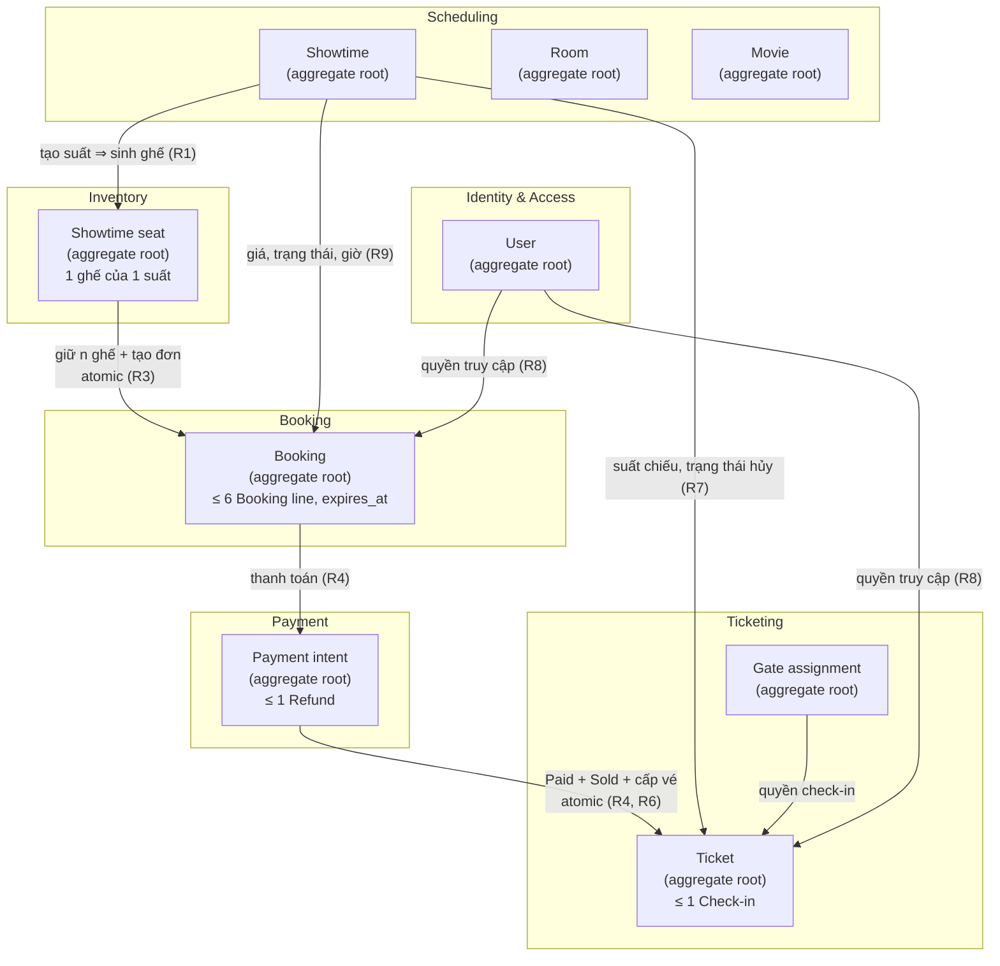

# Aggregates và invariants

Lớp 2 — Domain. Ranh giới nhất quán của hệ thống: **một aggregate bảo vệ được những invariant
nào, và invariant nào cần một phạm vi atomic rộng hơn?**

Thuật ngữ: [`GLOSSARY.md`](../../../GLOSSARY.md). Bản đồ context: [`../context-map.md`](../context-map.md).
Vòng đời: [`../state-machines.md`](../state-machines.md). Quy tắc nghiệp vụ gốc (`BR-nn`):
[`../../prd/04-business-rules.md`](../../prd/04-business-rules.md). Giảng khái niệm (entity, value
object, aggregate): [`../../learning/concepts.md`](../../learning/concepts.md#ddd-trong-project-này).

## Nguyên tắc đọc

1. **Ranh giới aggregate ≠ ranh giới atomic.** Aggregate là đơn vị nhất quán **nhỏ nhất** mà một
   invariant cần. Một lần ghi atomic có thể chạm **nhiều** aggregate — hợp lệ **khi được ghi rõ** (các
   "ranh giới bị cắt" bên dưới).
2. **Aggregate không phải lúc nào cũng đủ bảo vệ invariant.** Có invariant về bản chất nằm giữa nhiều
   aggregate — xem mục "Invariant KHÔNG bảo vệ được bằng một aggregate".
3. **Cơ chế mạnh nhất là ràng buộc ở tầng lưu trữ / điều kiện nằm trong lệnh ghi**, vì chặn được cả
   hai lệnh chạy **đồng thời** — kiểm tra trong ứng dụng thì không. Cơ chế cụ thể:
   [`../../design/concurrency.md`](../../design/concurrency.md).
4. **Có invariant là *hệ quả* của invariant khác.** Ghi lại để thấy chúng không cần cơ chế riêng —
   nhưng vẫn phải có test.

Mỗi file context ghi: invariant, cơ chế bảo vệ, **ai có thể vi phạm**, `Traces to` về `BR-nn`/`FR-nn`.
Invariant trích dẫn `BR-nn` thay vì nhắc lại nội dung quy tắc.

## File trong thư mục này

| File | Context | Aggregate chính |
|---|---|---|
| [`01-scheduling.md`](01-scheduling.md) | `Scheduling` | `Showtime`, `Room`, `Movie` |
| [`02-inventory.md`](02-inventory.md) | `Inventory` | `Showtime seat` |
| [`03-booking.md`](03-booking.md) | `Booking` | `Booking` |
| [`04-payment.md`](04-payment.md) | `Payment` | `Payment intent` |
| [`05-ticketing.md`](05-ticketing.md) | `Ticketing` | `Ticket`, `Gate assignment` |
| [`06-identity-access.md`](06-identity-access.md) | `Identity & Access` | `User` |

---

## Một suất chiếu có phải là một aggregate không?

**Không. Mỗi `Showtime seat` là một aggregate root (ADR-0005).**

| | Ranh giới | All-or-nothing do đâu | Kích thước | Kết luận |
|---|---|---|---|---|
| (a) | `Showtime` chứa toàn bộ `Showtime seat` | Aggregate | ~200 dòng | Không chọn: contention dồn một chỗ khi mở bán hot |
| **(b)** | **`Showtime seat` là aggregate root riêng** | **Một lần ghi atomic** | **1 dòng** | **Chọn** |
| (c) | Một aggregate "giữ ghế" chứa ≤ 6 ghế (ADR-0004) | Aggregate | ≤ 6 dòng | Không chọn: vòng đời entity không khớp (ghế sống qua nhiều lần giữ); trùng 1:1 với `Booking` |

- `BR-01` (một ghế một chủ) là invariant về **một** ghế ⇒ aggregate một ghế là đủ, ép bằng **điều
  kiện nằm trong lệnh**: hai lệnh cùng lúc thì chỉ một thắng.
- `BR-02` (giữ n ghế all-or-nothing) do **một lần ghi atomic** chạm n aggregate ghế + 1 `Booking`
  bảo đảm. Atomic cập nhật N dòng trong cùng một database vẫn trọn vẹn; chỉ khi N aggregate nằm ở N
  database mới cần compensating. Đây là ngoại lệ **có chủ ý** so với "một lần ghi một aggregate" —
  ghi ở ranh giới bị cắt #1.
- **Thứ tự khoá** (quota trước, ghế tăng dần) chống deadlock (`BR-22`). Ranh giới aggregate trả lời
  "nhất quán cái gì"; nó không trả lời "khoá theo thứ tự nào".

---

## Bảng tổng hợp: aggregate → invariant → cơ chế bảo vệ

| Aggregate | Context | Invariant chính | Cơ chế bảo vệ |
|---|---|---|---|
| `Showtime seat` | `Inventory` | `INV-01` 1 ghế = 1 chủ | Điều kiện trong lệnh + ràng buộc trạng thái |
| `Showtime seat` | `Inventory` | `INV-02` `Held` ⇔ có `hold_id` + `held_until` | Ràng buộc trên cùng một dòng |
| `Showtime seat` | `Inventory` | `INV-03` trả ghế chỉ trả ghế của đúng lần giữ | Điều kiện trong lệnh theo `hold_id` |
| `Showtime seat` | `Inventory` | `INV-04` ghế `Blocked` không bán | Lệnh giữ chỉ nhận ghế giữ được |
| `Booking` | `Booking` | `INV-01` 1 đơn = 1 suất chiếu | **Hình dạng dữ liệu** |
| `Booking` | `Booking` | `INV-02` giá đã chốt, lấy từ server | Value object bất biến + không nhận loại ghế từ client |
| `Booking` | `Booking` | `INV-03` ≤ 6 ghế/đơn | Kiểm tra ở biên aggregate |
| `Booking` | `Booking` | `INV-05` một chiều; quá hạn không `Paid` | State machine + điều kiện `expires_at > now` |
| `Booking` | `Booking` | `INV-07` lịch sử append-only | Aggregate chỉ thêm |
| `Booking` | `Booking` | `INV-08` 1 yêu cầu = 1 kết quả | **Bản ghi idempotency** theo (người, định danh yêu cầu) |
| `Booking` | `Booking` | `INV-10` ≤ 10 ghế/người/suất | **Khoá theo (người, suất)** trong lần giữ ghế |
| `Ticket` | `Ticketing` | `INV-01` 1 ghế = 1 vé | Ràng buộc duy nhất theo ghế |
| `Ticket` | `Ticketing` | `INV-03` 1 vé = 1 check-in | Ràng buộc duy nhất theo vé ở bản ghi check-in |
| `Ticket` | `Ticketing` | `INV-05` quét lại → từ chối, kèm giờ và cổng | Đọc bản ghi đã có |
| `Gate assignment` | `Ticketing` | `INV-08` chỉ check-in suất được phân công | Kiểm tra phân công ở lệnh check-in |
| `Payment intent` | `Payment` | `INV-01` thông báo lặp → xử lý 1 lần | Ràng buộc duy nhất theo `event.id` |
| `Payment intent` | `Payment` | `INV-02` hoàn đúng 1 lần | ≤ 1 `Refund` + khoá idempotency phía Stripe |
| `Payment intent` | `Payment` | `INV-04` thất bại không kết thúc intent | Hình dạng mô hình |
| `Showtime` | `Scheduling` | `INV-01` giá theo (suất × loại ghế) | Ràng buộc duy nhất theo (suất, loại ghế) |
| `Showtime` | `Scheduling` | `INV-02` chỉ giữ ghế suất đang bán, chưa chiếu | Kiểm tra trạng thái + giờ (xuyên ranh giới) |
| `Showtime` | `Scheduling` | `INV-04` chỉ chủ sở hữu sửa lịch chiếu | Kiểm tra quyền ở biên aggregate |
| `Room` | `Scheduling` | `INV-08` vị trí ghế duy nhất trong phòng | Ràng buộc duy nhất theo (phòng, hàng, số) |
| `Room` | `Scheduling` | `INV-09` không có "sức chứa" cấu hình | **Hình dạng mô hình** — số ghế là phép đếm |
| `Room` | `Scheduling` | `INV-13` không sửa sơ đồ khi còn suất chưa kết thúc | Kiểm tra ở lệnh sửa sơ đồ |
| `Room` | `Scheduling` | `INV-14` suất chỉ tạo trên phòng của mình | Kiểm tra chủ phòng ở lệnh tạo suất |
| `Movie` | `Scheduling` | `INV-11` chỉ hiện phim có suất đang bán | Suy ra từ dữ liệu, không lưu cờ |
| `User` | `Identity & Access` | `INV-01` chỉ quản trị viên cấp/thu quyền | Kiểm tra vai trò ở biên aggregate |
| `User` | `Identity & Access` | `INV-02` thu quyền có hiệu lực ngay + có dấu vết | Một lần ghi atomic; vai trò không đọc từ token |

---

## Invariant KHÔNG bảo vệ được bằng **một aggregate**

Cả ba đều **bảo vệ được bằng một lần ghi atomic** (hoặc một ràng buộc ở tầng lưu trữ). Cái chúng không
có là **một aggregate** đủ chứa chúng.

| # | Invariant | Vì sao không nằm trong một aggregate | Cơ chế đã chọn |
|---|---|---|---|
| 1 | **`BR-08`** — ≤ 10 ghế mỗi người mỗi suất | **Tích luỹ xuyên nhiều aggregate**: đếm theo *người* qua *nhiều đơn* | **Khoá theo (người, suất)** giữ tới hết lần giữ ghế, rồi mới đếm (ADR-0007). Không có cửa sổ race; khoá chỉ tranh giữa các yêu cầu của chính người đó cho chính suất đó |
| 2 | **`BR-20`** — không có hai suất chiếu chồng nhau ở cùng phòng | **Quan hệ giữa hai aggregate** `Showtime` | **Ràng buộc loại trừ** theo (phòng, khoảng thời gian + đệm 15 phút), bỏ qua suất `Cancelled` |
| 3 | **`BR-17`** — thông báo thanh toán lặp chỉ cấp vé một lần | **Điều phối nhiều aggregate** ở ba context (`Payment` → `Booking` → `Ticketing`) | Ràng buộc duy nhất theo `event.id` + **một lần ghi atomic** chạm cả ba (R4, R6) |

`BR-10` (mỗi vé chỉ check-in một lần) **không** nằm trong bảng này: nó là invariant về **một vé**,
hai lượt quét đồng thời là hai lệnh tranh **một dòng**, ràng buộc duy nhất là đủ. Một invariant
trông "toàn cục" có thể hoá "cục bộ" nếu đặt ranh giới đúng chỗ — ngược lại, `BR-08` trông cục bộ
nhưng hoá toàn cục.

---

## Ranh giới bị cắt — năm chỗ

Nơi **một lần ghi atomic** chạm aggregate ở **nhiều context**. Trong modular monolith đó là một
transaction, **chỉ gồm ghi database**; gọi ra ngoài (Stripe, email) luôn bất đồng bộ. Trong
modular monolith mỗi chỗ là **một** transaction; không được "tối ưu" bằng cách chia nhỏ mà không đổi
logic. Đây là danh sách chuẩn duy nhất.

| # | Bất biến bị cắt | Cắt ở đâu | Transition | Hậu quả nếu tách service |
|---|---|---|---|---|
| 1 | "Giữ n ghế: đủ n hoặc không ghế nào" + "đơn và ghế giữ cùng hạn" | R3 — `Inventory` + `Booking` (đọc R9) | `Hold seats` | Saga giữ ghế; có lúc ghế giữ mà chưa có đơn |
| 2 | "Thu tiền ⇒ đơn `Paid` ⇒ ghế `Sold` ⇒ cấp vé, đúng một lần" | R4 + R6 + R3 — `Payment`, `Booking`, `Inventory`, `Ticketing` | `AwaitingPayment → Paid` | Outbox + consumer idempotent; cấp vé hai lần nếu làm sai (nguy hiểm nhất: sinh ra lỗi sai chứ không chỉ chậm hơn) |
| 3 | "Hết hạn / huỷ: trả ghế + chuyển đơn cùng lúc" | R3 | `→ Expired`, `→ Cancelled` | Compensating; lệnh trả ghế theo `hold_id` giúp không trả nhầm |
| 4 | "Hủy suất: huỷ đơn chờ + yêu cầu hoàn mọi đơn đã trả" | R9 + R3 + R4 — `Scheduling`, `Booking`, `Inventory`, `Payment` | `OnSale → Cancelled` | Một sự kiện sinh N lượt xử lý, mỗi lượt idempotent. Phần gọi Stripe **đã** bất đồng bộ ngay trong monolith |
| 5 | "Suất tồn tại ⇔ ghế của suất tồn tại đủ" | R1 — `Scheduling` + `Inventory` | Tạo suất | Saga tạo suất; có lúc suất tồn tại mà chưa có ghế |

Ứng viên tách service theo từng quan hệ: [`../../design/architecture.md`](../../design/architecture.md).

---

## Sơ đồ aggregate

Mũi tên ghi **"atomic"** là nơi một lần ghi chạm **nhiều aggregate ở nhiều context** — bảng "ranh giới
bị cắt" ở trên.

---

## Entity và Value Object

| Thứ | Loại | Vì sao |
|---|---|---|
| `Showtime`, `Room`, `Movie` | Entity | Có định danh, có vòng đời |
| `Room seat` | Entity | Có định danh (vị trí trong phòng), tồn tại lâu dài |
| `Showtime seat` | Entity (aggregate root) | Có định danh, vòng đời = vòng đời suất chiếu |
| `Booking`, `Booking line` | Entity | Có định danh |
| `Ticket`, `Check-in` | Entity | Có định danh |
| `Gate assignment` | Entity | Có định danh, tạo/gỡ được |
| `Payment intent`, `Refund` | Entity | Có định danh |
| `User` | Entity | Có định danh |
| Thông tin giữ (`hold_id`, `held_until`) | **Value Object** | Thay nguyên khối khi giữ/trả |
| `Ticket price`, `Seat type` | **Value Object** | Chỉ có giá trị |
| Vị trí ghế (hàng, số) | **Value Object** | Chỉ có giá trị |
| Số tiền, đơn vị tiền tệ | **Value Object** | Chỉ có giá trị |
| Thời điểm hết hạn | **Value Object** | Chỉ có giá trị |
| Vai trò (`Customer`, ...) | **Value Object** | Chỉ có giá trị |

---

## Không aggregate nào chứa thứ thuộc về aggregate khác

| Aggregate | Chứa thứ của context khác? | Ghi chú |
|---|---|---|
| `Showtime seat` | Không | Tham chiếu `Showtime`, `Room seat`; `hold_id` là tham chiếu không diễn giải |
| `Booking` | Không | `Ticket price` **đã chốt** là bản sao, không phải tham chiếu sống |
| `Payment intent` | Không | Chỉ tham chiếu `Booking id` |
| `Ticket` | Không | Tham chiếu `Booking id`, `Showtime seat id`; **bản sao** `Customer id` |
| `Gate assignment` | Không | Tham chiếu `Showtime id`, `User id` |
| `Showtime` | Không | Chứa `Ticket price` **của chính nó** |
| `Room` | Không | Chứa `Room seat` **của chính nó** |
