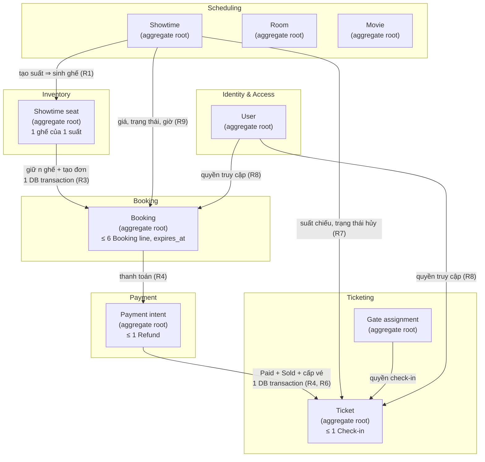

# Aggregates và invariants

Lớp 2 — Domain. Ranh giới nhất quán của hệ thống: **một aggregate bảo vệ được những invariant
nào, và invariant nào cần một DB transaction rộng hơn?**

Nguồn: ticket `.scratch/advanced-ticket-system/issues/07-aggregates-invariants.md`.
Thuật ngữ: [`../ubiquitous-language.md`](../ubiquitous-language.md).
Bản đồ context: [`../context-map.md`](../context-map.md).
Sửa lớn 2026-11-25 sau review: [ADR-0005](../../adr/0005-showtime-seat-aggregate.md),
[ADR-0006](../../adr/0006-payment-expiry-refund-flow.md),
[ADR-0007](../../adr/0007-per-customer-showtime-quota.md).

## Cách đọc

1. **Ranh giới aggregate ≠ ranh giới DB transaction.** Aggregate là đơn vị nhất quán **nhỏ nhất**
   mà một invariant cần. Một DB transaction có thể chạm **nhiều** aggregate — trong modular
   monolith điều đó hợp lệ **khi được ghi rõ** (các "ranh giới bị cắt"). Lẫn hai khái niệm này là
   lỗi của bản T07 đầu tiên.
2. **Aggregate không phải lúc nào cũng đủ để bảo vệ invariant.** Có invariant về bản chất không
   nằm trong một aggregate — xem bảng ở mục dưới, kèm cơ chế thay thế.
3. **Cơ chế mạnh nhất là ràng buộc ở tầng lưu trữ / điều kiện lệnh**, vì chặn được cả hai lệnh
   chạy **đồng thời** — kiểm tra trong ứng dụng thì không.
4. **Có invariant là *hệ quả* của invariant khác.** Ghi lại để thấy chúng không cần cơ chế riêng —
   nhưng vẫn phải có test.

## File trong thư mục này

| File | Context | Aggregate chính |
|---|---|---|
| [`01-scheduling.md`](01-scheduling.md) | `Scheduling` | `Showtime`, `Room`, `Movie` |
| [`02-inventory.md`](02-inventory.md) | `Inventory` | `Showtime seat` |
| [`03-booking.md`](03-booking.md) | `Booking` | `Booking` |
| [`04-payment.md`](04-payment.md) | `Payment` | `Payment intent` |
| [`05-ticketing.md`](05-ticketing.md) | `Ticketing` | `Ticket`, `Gate assignment` |
| [`06-identity-access.md`](06-identity-access.md) | `Identity & Access` | `User` |

---

## Câu hỏi trọng tâm của Gate B: một suất chiếu có phải là một aggregate không?

**Câu trả lời: KHÔNG. Mỗi `Showtime seat` là một aggregate root (ADR-0005).**

| | Ranh giới | All-or-nothing do đâu | Kích thước | Kết luận |
|---|---|---|---|---|
| (a) | `Showtime` chứa toàn bộ `Showtime seat` | Aggregate | ~200 dòng | Contention dồn một chỗ khi mở bán hot |
| **(b)** | **`Showtime seat` là aggregate root riêng** | **Một DB transaction** | **1 dòng** | **Chọn** |
| (c) | `Seat hold` chứa ≤ 6 ghế (ADR-0004, đã bị thay) | Aggregate | ≤ 6 dòng | Vòng đời entity không khớp; trùng `Booking` |

**Điểm mấu chốt:**

- `BR-01` (một ghế một chủ) là invariant về **một** ghế ⇒ aggregate một ghế là đủ, ép bằng **điều
  kiện lệnh** (`UPDATE … WHERE status = 'Available'`): không có cửa sổ TOCTOU, hai lệnh cùng lúc thì
  chỉ một thắng.
- `BR-02` (giữ n ghế all-or-nothing) được bảo đảm bởi **một DB transaction** chạm n aggregate ghế +
  1 `Booking`. Đây là ngoại lệ **có chủ ý** so với "một transaction một aggregate" — ghi ở ranh giới
  bị cắt R3.
- **Thứ tự khoá** (quota trước, ghế tăng dần theo id) chống deadlock (`BR-22`). Ranh giới aggregate
  trả lời "nhất quán cái gì"; nó không trả lời "khoá theo thứ tự nào".

> **Bài học của lần sửa này.** Bản T07 đầu tiên bác (b) vì "all-or-nothing qua N aggregate phải
> dùng compensating transaction". Điều đó chỉ đúng khi N aggregate nằm ở N database. Trong một
> database, một transaction cập nhật N dòng vẫn atomic. Lý do sai đã dẫn tới một aggregate (`Seat
> hold`) mà vòng đời không khớp với entity bên trong nó.

---

## Bảng tổng hợp: aggregate → invariant → cơ chế bảo vệ

| Aggregate | Context | Invariant chính | Cơ chế bảo vệ |
|---|---|---|---|
| `Showtime seat` | `Inventory` | `INV-01` 1 ghế = 1 chủ | Điều kiện lệnh + `CHECK` trạng thái |
| `Showtime seat` | `Inventory` | `INV-02` `Held` ⇔ có `hold_id` + `held_until` | `CHECK` trên cùng một dòng |
| `Showtime seat` | `Inventory` | `INV-03` trả ghế chỉ trả ghế của đúng lần giữ | Điều kiện lệnh theo `hold_id` |
| `Showtime seat` | `Inventory` | `INV-04` ghế `Blocked` không bán | Điều kiện lệnh chỉ nhận `Available` |
| `Booking` | `Booking` | `INV-01` 1 đơn = 1 suất chiếu | **Hình dạng dữ liệu** |
| `Booking` | `Booking` | `INV-02` giá đã chốt, lấy từ server | Value object bất biến + không nhận loại ghế từ client |
| `Booking` | `Booking` | `INV-03` ≤ 6 ghế/đơn | Kiểm tra ở biên aggregate |
| `Booking` | `Booking` | `INV-05` một chiều; quá hạn không `Paid` | State machine + điều kiện `expires_at > now()` |
| `Booking` | `Booking` | `INV-07` lịch sử append-only | Aggregate chỉ thêm |
| `Booking` | `Booking` | `INV-08` 1 yêu cầu = 1 kết quả | **Bản ghi idempotency** unique `(customer, key)` |
| `Booking` | `Booking` | `INV-10` ≤ 10 ghế/người/suất | **Khoá theo (người, suất)** trong transaction giữ ghế |
| `Ticket` | `Ticketing` | `INV-01` 1 ghế = 1 vé | Ràng buộc duy nhất trên `showtime_seat_id` |
| `Ticket` | `Ticketing` | `INV-03` 1 vé = 1 check-in | Ràng buộc duy nhất trên `ticket_id` ở bảng check-in |
| `Ticket` | `Ticketing` | `INV-05` quét lại → từ chối, kèm giờ và cổng | Đọc dòng ghi nhận đã có |
| `Gate assignment` | `Ticketing` | `INV-08` chỉ check-in suất được phân công | Kiểm tra phân công ở lệnh check-in |
| `Payment intent` | `Payment` | `INV-01` webhook lặp → xử lý 1 lần | Ràng buộc duy nhất trên `event.id` |
| `Payment intent` | `Payment` | `INV-02` hoàn đúng 1 lần | ≤ 1 `Refund` + `Idempotency-Key` phía Stripe |
| `Payment intent` | `Payment` | `INV-04` thất bại không kết thúc intent | Hình dạng mô hình |
| `Showtime` | `Scheduling` | `INV-01` giá theo (suất × loại ghế) | Ràng buộc duy nhất `(showtime, seat_type)` |
| `Showtime` | `Scheduling` | `INV-02` chỉ giữ ghế suất đang bán, chưa chiếu | Kiểm tra trạng thái + giờ (xuyên ranh giới) |
| `Showtime` | `Scheduling` | `INV-04` chỉ chủ sở hữu sửa lịch chiếu | Kiểm tra quyền ở biên aggregate |
| `Room` | `Scheduling` | `INV-08` vị trí ghế duy nhất trong phòng | Ràng buộc duy nhất `(room, row, number)` |
| `Room` | `Scheduling` | `INV-09` không có "sức chứa" cấu hình | **Hình dạng mô hình** — số ghế là phép đếm |
| `Room` | `Scheduling` | `INV-13` không sửa sơ đồ khi còn suất chưa kết thúc | Kiểm tra ở lệnh sửa sơ đồ |
| `Movie` | `Scheduling` | `INV-11` chỉ hiện phim có suất đang bán | Suy ra từ dữ liệu, không lưu cờ |
| `User` | `Identity & Access` | `INV-01` chỉ admin cấp/thu quyền | Kiểm tra vai trò ở biên aggregate |
| `User` | `Identity & Access` | `INV-02` thu quyền có hiệu lực ngay + có dấu vết | Một transaction; vai trò không đọc từ token |

Đầy đủ invariant nằm trong 6 file chi tiết — mỗi cái ghi cơ chế bảo vệ, **ai có thể vi phạm**, và
`Traces to` về `BR-nn`/`FR-nn`.

---

## Invariant KHÔNG bảo vệ được bằng **một aggregate**

Phân biệt rõ: cả ba đều **bảo vệ được bằng một DB transaction** (hoặc một ràng buộc ở tầng lưu
trữ). Cái chúng không có là **một aggregate** đủ chứa chúng.

| # | Invariant | Vì sao không nằm trong một aggregate | Cơ chế đã chọn |
|---|---|---|---|
| 1 | **`BR-08`** — ≤ 10 ghế mỗi người mỗi suất | **Tích luỹ xuyên nhiều aggregate**: đếm theo *người* qua *nhiều đơn* | **Khoá theo (người, suất)** giữ tới hết transaction giữ ghế, rồi mới đếm (ADR-0007). Không còn cửa sổ race |
| 2 | **`BR-20`** — không có hai suất chiếu chồng nhau ở cùng phòng | **Quan hệ giữa hai aggregate** `Showtime` | **Exclusion constraint** trên `(room_id, khoảng thời gian + đệm)`, bỏ qua suất `Cancelled` |
| 3 | **`BR-17`** — thông báo thanh toán lặp chỉ cấp vé một lần | **Điều phối nhiều aggregate** ở ba context (`Payment` → `Booking` → `Ticketing`) | Ràng buộc duy nhất trên `event.id` + **một DB transaction** chạm cả ba (R4, R6) |

> **Đã sửa (2026-11-25):** `BR-08` trước đây "chấp nhận cửa sổ race". Lý do gốc ("chỉ người dùng
> tự hại", "khoá là điểm tranh chấp toàn cục") đều sai — xem ADR-0007.

### Vì sao `BR-10` (mỗi vé chỉ check-in một lần) *không* nằm trong bảng này

Nó là invariant về **một vé**: hai lượt quét đồng thời là hai transaction tranh **một dòng**.
Ràng buộc duy nhất là đủ. **Một invariant trông "toàn cục" có thể hoá thành "cục bộ"** nếu đặt
ranh giới aggregate đúng chỗ — ngược lại, `BR-08` trông cục bộ nhưng hoá thành toàn cục.

---

## Sơ đồ aggregate

> Mũi tên ghi **"1 DB transaction"** là nơi một transaction chạm **nhiều aggregate ở nhiều
> context** — xem bảng "ranh giới bị cắt" ở [`../state-machines.md`](../state-machines.md).

---

## Entity và Value Object

| Thứ | Loại | Vì sao |
|---|---|---|
| `Showtime`, `Room`, `Movie` | Entity | Có định danh, có vòng đời |
| `Room seat` | Entity | Có định danh (vị trí trong phòng), tồn tại lâu dài |
| `Showtime seat` | Entity (aggregate root) | Có định danh, vòng đời = vòng đời suất chiếu |
| `Booking`, `Booking line` | Entity | Có định danh |
| `Ticket`, `Check-in` | Entity | Có định danh |
| `Gate assignment` | Entity | Có định danh, tạo/gỡ được |
| `Payment intent`, `Refund` | Entity | Có định danh |
| `User` | Entity | Có định danh |
| Thông tin giữ (`hold_id`, `held_until`) | **Value Object** | Thay nguyên khối khi giữ/trả |
| `Ticket price`, `Seat type` | **Value Object** | Chỉ có giá trị |
| Vị trí ghế (hàng, số) | **Value Object** | Chỉ có giá trị |
| Số tiền, đơn vị tiền tệ | **Value Object** | Chỉ có giá trị |
| Thời điểm hết hạn | **Value Object** | Chỉ có giá trị |
| Vai trò (`Customer`, ...) | **Value Object** | Chỉ có giá trị |

Tên bảng cụ thể (`showtime_seats`, `bookings`, `booking_lines`, `payment_intents`, ...) để T11 chốt.

---

## Không aggregate nào chứa thứ thuộc về aggregate khác

| Aggregate | Chứa thứ của context khác? | Ghi chú |
|---|---|---|
| `Showtime seat` | Không | Tham chiếu `Showtime`, `Room seat`; `hold_id` là tham chiếu không diễn giải |
| `Booking` | Không | `Ticket price` **đã chốt** là bản sao, không phải tham chiếu sống |
| `Payment intent` | Không | Chỉ tham chiếu `Booking id` |
| `Ticket` | Không | Chỉ tham chiếu `Booking id`, `Showtime seat id` |
| `Gate assignment` | Không | Tham chiếu `Showtime id`, `User id` |
| `Showtime` | Không | Chứa `Ticket price` **của chính nó** |
| `Room` | Không | Chứa `Room seat` **của chính nó** |

---

## Trạng thái

Bản làm việc, sửa lớn sau review 2026-11-25. Câu hỏi còn mở chuyển sang Gate C:

- Ghế `Held` đã quá `held_until` mà worker chưa trả — có cho lệnh giữ mới lấy luôn không? (Q25, T12)
- Giá trị khoảng đệm giữa hai suất chiếu cùng phòng (Q22, T13).
