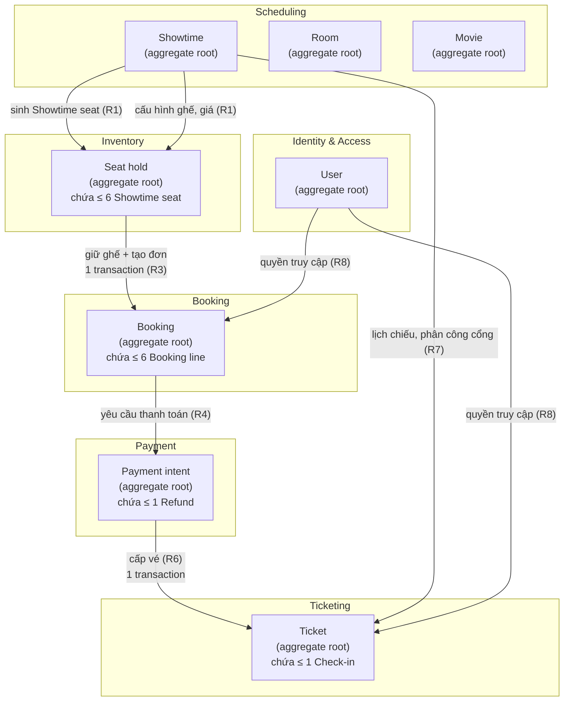

# Aggregates và invariants

Lớp 2 — Domain. Ranh giới nhất quán của hệ thống: **một transaction duy nhất bảo vệ được những
invariant nào?**

Nguồn: ticket `.scratch/advanced-ticket-system/issues/07-aggregates-invariants.md`.
Thuật ngữ: [`../ubiquitous-language.md`](../ubiquitous-language.md).
Bản đồ context: [`../context-map.md`](../context-map.md).

## Cách đọc

Bốn điều cần nhớ khi đọc bộ tài liệu này:

1. **Ranh giới aggregate = ranh giới transaction.** Chốt được ranh giới thì phần lớn câu hỏi
   "dùng cơ chế concurrency nào" tự động có đáp án.
2. **Aggregate không phải lúc nào cũng đủ để bảo vệ invariant.** Có những invariant về bản chất
   **không thể** nằm trong một aggregate — xem bảng ở mục dưới. Ghi ra tường minh kèm hậu quả
   thành một thứ đã cân nhắc, thay vì che bằng lời hứa suông.
3. **Một invariant có thể được ép bằng nhiều cơ chế.** Cơ chế mạnh nhất là ràng buộc ở tầng lưu
   trữ, vì nó chặn được cả hai lệnh chạy **đồng thời** — mà kiểm tra trong ứng dụng thì không.
4. **Có invariant là *hệ quả* của invariant khác.** Chúng được ghi lại để thấy rõ chúng không
   cần cơ chế riêng — nhưng vẫn phải có test.

## File trong thư mục này

| File | Context | Aggregate chính |
|---|---|---|
| [`01-scheduling.md`](01-scheduling.md) | `Scheduling` | `Showtime`, `Room`, `Movie` |
| [`02-inventory.md`](02-inventory.md) | `Inventory` | `Seat hold` |
| [`03-booking.md`](03-booking.md) | `Booking` | `Booking` |
| [`04-payment.md`](04-payment.md) | `Payment` | `Payment intent` |
| [`05-ticketing.md`](05-ticketing.md) | `Ticketing` | `Ticket` |
| [`06-identity-access.md`](06-identity-access.md) | `Identity & Access` | `User` |

---

## Câu hỏi trọng tâm của Gate B: một suất chiếu có phải là một aggregate không?

**Câu trả lời: KHÔNG.**

Một suất chiếu có hàng trăm ghế. Nếu `Showtime` là aggregate chứa toàn bộ `Showtime seat`, thì:

- mỗi lần giữ ghế là một transaction trên một tập dòng rất lớn;
- khi mở bán phim hot, hàng nghìn người tranh cùng một suất ⇒ **contention dồn vào một
  aggregate**;
- và tệ hơn: `BR-02` (giữ n ghế all-or-nothing) sẽ kéo `Booking` vào cùng aggregate đó — tức
  là một aggregate vừa chứa hàng trăm ghế, vừa chứa đơn, vừa chứa lịch sử.

**Đã chọn (c): `Seat hold` là aggregate root.**

| | Ranh giới | All-or-nothing | Kích thước | Ai ép "1 ghế = 1 chủ" |
|---|---|---|---|---|
| (a) | `Showtime` chứa toàn bộ `Showtime seat` | Tự nhiên | 200 dòng | Aggregate |
| (b) | `Showtime seat` là aggregate root riêng | Phải qua N aggregate | 1 dòng | Constraint + điều kiện lệnh |
| **(c)** | **`Seat hold` là aggregate root, chứa ≤6 ghế** | **Gói trong 1 aggregate** | **≤6 dòng** | **Constraint + điều kiện lệnh** |

Lý do đầy đủ: [`02-inventory.md` — mục "Ranh giới aggregate: vì sao không phải `Showtime"`](02-inventory.md#ranh-giới-aggregate-vì-sao-không-phải-showtime).

**Điểm mấu chốt:** `BR-02` (all-or-nothing) **không được phép bị cắt**. Ở phương án (b), mọi cơ
chế đảm bảo "đủ 4 hoặc không ghế nào" đều là *compensating transaction* — tức là có thời điểm
hệ thống ở trạng thái trung gian vi phạm `BR-02`. Ở phương án (c), toàn bộ n ghế nằm trong một
aggregate ⇒ một transaction ⇒ all-or-nothing là điều cơ sở dữ liệu bảo đảm.

**Và điều này không có nghĩa là aggregate không đủ.** `INV-01` (một ghế thuộc đúng một chủ)
được ép bằng **điều kiện lệnh** (`UPDATE ... WHERE status = 'Available'`), mạnh hơn khoá
đọc-sửa-ghi: không có cửa sổ TOCTOU, và hai lệnh cùng lúc trên cùng một ghế thì **chỉ một**
thắng — lệnh còn lại ảnh hưởng 0 dòng và phải được coi là thất bại.

---

## Bảng tổng hợp: aggregate → invariant → cơ chế bảo vệ

| Aggregate | Context | Invariant chính | Cơ chế bảo vệ |
|---|---|---|---|
| `Seat hold` | `Inventory` | `INV-01` 1 ghế = 1 chủ | Điều kiện lệnh + `CHECK` trạng thái |
| `Seat hold` | `Inventory` | `INV-02` giữ n ghế all-or-nothing | **Một transaction** (aggregate ≤6 ghế) |
| `Seat hold` | `Inventory` | `INV-03` mọi lần giữ có hạn | `expires_at` NOT NULL + bắt buộc ở constructor |
| `Seat hold` | `Inventory` | `INV-05` ≤6 ghế | Kiểm tra ở biên aggregate |
| `Seat hold` | `Inventory` | `INV-07` ghế `Blocked` không bán | Điều kiện lệnh chỉ nhận `Available` |
| `Booking` | `Booking` | `INV-01` 1 đơn = 1 suất chiếu | **Hình dạng dữ liệu** (một tham chiếu) |
| `Booking` | `Booking` | `INV-02` giá đã chốt, tổng = tổng từng ghế | Value object bất biến + tổng tính từ dòng |
| `Booking` | `Booking` | `INV-03` ≤6 ghế/đơn | Kiểm tra ở biên aggregate |
| `Booking` | `Booking` | `INV-05` trạng thái đi một chiều | State machine + aggregate từ chối lệnh sai |
| `Booking` | `Booking` | `INV-07` lịch sử append-only | Aggregate chỉ thêm |
| `Booking` | `Booking` | `INV-08` 1 yêu cầu = 1 đơn | **Ràng buộc duy nhất** trên định danh yêu cầu |
| `Ticket` | `Ticketing` | `INV-01` 1 ghế = 1 vé | **Ràng buộc duy nhất** trên `showtime_seat_id` |
| `Ticket` | `Ticketing` | `INV-03` 1 vé = 1 check-in | **Ràng buộc duy nhất** trên `ticket_id` ở bảng check-in |
| `Ticket` | `Ticketing` | `INV-05` quét lại → từ chối, kèm giờ và cổng | Đọc dòng ghi nhận đã có |
| `Payment intent` | `Payment` | `INV-01` webhook lặp → xử lý 1 lần | **Ràng buộc duy nhất** trên `event.id` |
| `Payment intent` | `Payment` | `INV-02` hoàn đúng 1 lần | **Ràng buộc duy nhất**: 1 `Payment intent` ↔ ≤1 `Refund` |
| `Payment intent` | `Payment` | `INV-03` hoàn bằng đúng số đã thu | Kiểm tra trong aggregate |
| `Showtime` | `Scheduling` | `INV-01` giá theo (suất × loại ghế) | Ràng buộc duy nhất `(showtime, seat_type)` |
| `Showtime` | `Scheduling` | `INV-02` chỉ đặt vé được suất đang bán | Kiểm tra trạng thái trước khi ghi (xuyên ranh giới) |
| `Showtime` | `Scheduling` | `INV-04` chỉ chủ sở hữu sửa lịch chiếu | Kiểm tra quyền ở biên aggregate |
| `Room` | `Scheduling` | `INV-08` vị trí ghế duy nhất trong phòng | Ràng buộc duy nhất `(room, row, number)` |
| `Room` | `Scheduling` | `INV-09` không có "sức chứa" cấu hình | **Hình dạng mô hình** — số ghế là phép đếm |
| `Movie` | `Scheduling` | `INV-11` chỉ hiện phim có suất đang bán | Suy ra từ dữ liệu, không lưu cờ |
| `User` | `Identity & Access` | `INV-01` chỉ admin cấp/thu quyền | Kiểm tra vai trò ở biên aggregate |
| `User` | `Identity & Access` | `INV-02` thu quyền có hiệu lực ngay + có dấu vết | Một transaction (gỡ quyền + ghi log) |

Bảng này liệt kê **invariant chính** của mỗi aggregate. Đầy đủ **47 invariant** nằm trong 6 file
chi tiết — mỗi cái ghi cơ chế bảo vệ, **ai có thể vi phạm**, và `Traces to` về `BR-nn`/`FR-nn`.

---

## Invariant KHÔNG bảo vệ được bằng một transaction đơn lẻ

Đây là một trong những tiêu chí bắt buộc của ticket T07. Có **ba** dạng, và mỗi dạng cần một
cơ chế khác nhau:

| # | Invariant | Vì sao không bảo vệ được | Cơ chế đã chọn | Hệ quả được chấp nhận |
|---|---|---|---|---|
| 1 | **`BR-08`** — ≤10 ghế mỗi người mỗi suất, cộng dồn qua các đơn | **Tích luỹ xuyên nhiều aggregate**: đếm theo *người*, qua *nhiều đơn*. Ranh giới `Booking` bảo vệ *một* đơn | Quy tắc ở tầng ứng dụng (đọc tổng ghế đang giữ của người rồi so với 10) | **Có cửa sổ race**: hai yêu cầu đồng thời có thể cùng đọc "đang giữ 8 ghế" và cùng tạo đơn → tổng 12. Chấp nhận được vì đây là rủi ro *người dùng tự gian lận*, không phải *bán quá số ghế có thật* — và vì ép bằng khoá ở tầng DB sẽ thêm một điểm tranh chấp toàn cục vào đúng đường nóng nhất |
| 2 | **`BR-20`** — không có hai suất chiếu chồng nhau ở cùng phòng | **Quan hệ giữa hai aggregate**: hai `Showtime` khác nhau. Aggregate `Showtime` không thể ghi ra ngoài ranh giới của mình | **Ràng buộc loại trừ** (exclusion constraint) ở tầng lưu trữ trên `(room_id, khoảng thời gian)` | Bảo vệ nằm **ngoài** ranh giới aggregate — nhưng mạnh hơn kiểm tra ứng dụng, vì chặn được cả hai lệnh tạo suất chạy đồng thời. Cần **khoảng đệm** giữa hai suất (giá trị chốt ở T13) |
| 3 | **`BR-17`** — thông báo thanh toán đến lặp chỉ cấp vé một lần | **Cần điều phối nhiều bước**: xử lý tiền (`Payment`) → đánh dấu đơn (`Booking`) → cấp vé (`Ticketing`), cả ba ở ba context khác nhau | **Ràng buộc duy nhất** trên `event.id` ở lịch sử `Payment event`, kèm một transaction chung trong modular monolith | Trong modular monolith: cùng transaction ⇒ an toàn. Nếu tách service: phải có outbox + consumer idempotent, và phải xử lý riêng trường hợp **tiền đã thu nhưng đơn đã hết hạn** → hoàn tiền, không cấp vé (`BR-05`) |

> **Tại sao điều #3 lại là "không bảo vệ được" khi cơ chế ràng buộc duy nhất nghe rất mạnh?**
> Vì nó **không bảo vệ được bằng transaction của *một* aggregate**. Nó bảo vệ được bằng
> transaction **đi qua nhiều aggregate** — mà điều đó chính là ranh giới **R4** và **R6** bị cắt,
> đã ghi ở [`../context-map.md`](../context-map.md). Ba dạng "không bảo vệ được" đều có cùng một
> nguyên nhân gốc: **ranh giới aggregate không trùng ranh giới transaction**.

### Vì sao `BR-10` (mỗi vé chỉ check-in một lần) *không* nằm trong bảng này

Nghe thì `BR-10` cần một transaction xuyên nhiều vé, nhưng thực ra **không** — nó là invariant về
**một vé**, và hai lượt quét đồng thời là hai transaction cùng tranh **một dòng**. Ràng buộc
duy nhất là đủ.

Đây là điểm đáng học: **một invariant trông như "toàn cục" có thể hoá thành "cục bộ"** nếu ta
đặt ranh giới aggregate đúng chỗ. Ngược lại, `BR-08` trông như cục bộ (nó nằm trong một đơn)
nhưng hoá thành toàn cục — vì nó đếm theo **người** qua **nhiều đơn**.

---

## Sơ đồ aggregate

> Ba mũi tên được đánh dấu **"1 transaction"** là ba nơi **bất biến bị cắt ngang ranh giới
> context**. Xem [`../context-map.md` — mục "Nhóm ba ranh giới bị cắt"](../context-map.md).

---

## Entity và Value Object

| Thứ | Loại | Vì sao |
|---|---|---|
| `Showtime`, `Room`, `Movie` | Entity | Có định danh, có vòng đời |
| `Room seat` | Entity | Có định danh (vị trí trong phòng), tồn tại lâu dài |
| `Seat hold` | Entity | Có định danh, có vòng đời (từ lúc giữ đến lúc trả/bán) |
| `Showtime seat` | Entity | Có định danh, có vòng đời trạng thái |
| `Booking`, `Booking line` | Entity | Có định danh |
| `Ticket` | Entity | Có định danh (mã QR) |
| `Check-in` | Entity | Có định danh (lần quét) |
| `Payment intent`, `Refund` | Entity | Có định danh |
| `User` | Entity | Có định danh |
| `Ticket price` | **Value Object** | Chỉ có giá trị; đổi giá là tạo VO mới, không phải sửa |
| `Seat type` | **Value Object** | Chỉ có giá trị |
| Vị trí ghế (hàng, số) | **Value Object** | Chỉ có giá trị |
| Số tiền, đơn vị tiền tệ | **Value Object** | Chỉ có giá trị |
| Thời điểm hết hạn | **Value Object** | Chỉ có giá trị |
| Vai trò (`Customer`, ...) | **Value Object** | Chỉ có giá trị |

**Quy tắc đặt tên trong code**: dùng tên tiếng Anh trong
[`../ubiquitous-language.md`](../ubiquitous-language.md). Tên entity/bảng cụ thể
(`ShowtimeSeat`, `RoomSeat`, `SeatHold`, `BookingLine`, `PaymentIntent`) để T11 chốt.

---

## Không aggregate nào chứa thứ thuộc về aggregate khác

Đối chiếu với bảng **nguồn sự thật** ở [`../context-map.md`](../context-map.md):

| Aggregate | Chứa thứ của context khác? | Ghi chú |
|---|---|---|
| `Seat hold` | Không | Chỉ tham chiếu `Showtime` và `Room seat` (đọc) |
| `Booking` | Không | `Ticket price` **đã chốt** là bản sao của giá tại lúc giữ, không phải tham chiếu sống |
| `Payment intent` | Không | Chỉ tham chiếu `Booking id` |
| `Ticket` | Không | Chỉ tham chiếu `Booking id`, `Showtime seat id` |
| `Showtime` | Không | Chứa `Ticket price` **của chính nó** — giá thuộc suất chiếu × loại ghế |
| `Room` | Không | Chứa `Room seat` **của chính nó** |
| `Movie` | Không | — |

**Trường hợp cần nói rõ — `Gate assignment`:** nằm ở `Scheduling`, đọc bởi `Ticketing` (R7), và
**không** thuộc aggregate `Showtime`. Đây là dữ liệu **quan hệ** giữa suất chiếu và cổng, nên
nằm ngoài ranh giới aggregate hiện tại. Nếu sau này cần bảo vệ invariant "một cổng không phục
vụ hai suất chồng nhau" bằng transaction đơn lẻ, sẽ phải xem lại — hiện tại chưa có yêu cầu đó.

---

## Trạng thái

Bản làm việc. Sau T07, `docs/domain/` có: `ubiquitous-language.md` (T05), `context-map.md`
(T06), `aggregates/` (T07). Tiếp theo: T08 — state machines.

**Còn mở, chuyển sang ticket sau:**

- `BR-08` có nên nâng lên ràng buộc ở tầng lưu trữ không? (Q21)
- Giá trị khoảng đệm giữa hai suất chiếu cùng phòng — chốt ở T13.
- `BR-08` có cần được kiểm chứng bằng test concurrency thật, hay chỉ test logic? (T22)
