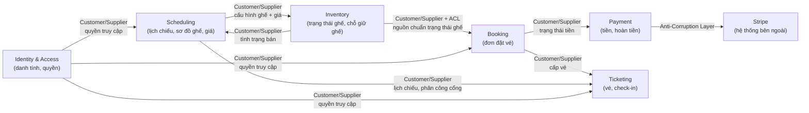

# Context map

Lớp 2 — Domain. Bản đồ các bounded context và quan hệ giữa chúng.

Nguồn: ticket `.scratch/advanced-ticket-system/issues/06-context-map.md`.
Thuật ngữ: [`ubiquitous-language.md`](ubiquitous-language.md).

## Cách đọc

Bốn điều cần nhớ khi đọc bản đồ này:

1. **Bounded context ≠ transaction boundary.** Bounded context là ranh giới *ngôn ngữ*; transaction
   boundary là ranh giới *atomicity*, chốt ở T07. Trong modular monolith hai thứ này **không trùng
   nhau** — và bản đồ này ghi rõ chỗ nào chúng tách.
2. **Tên tiếng Anh là tên chuẩn trong code.** Xem mục "Quy tắc đặt tên trong code" ở
   [`ubiquitous-language.md`](ubiquitous-language.md).
3. **Mỗi quan hệ có tên dạng quan hệ**, không phải mũi tên trần.
4. **Quan hệ nào đi qua API, quan hệ nào ghi chung transaction** — phải phân biệt. Đây là thông
   tin quan trọng nhất của bản đồ: nó quyết định cái gì sẽ **vỡ** nếu sau này tách service.

## Bối cảnh

Hệ thống đặt vé xem phim. Sáu bounded context, dựa trên 7 journey ở T04.

| Context | Tên tiếng Anh | Trách nhiệm (một câu) |
|---|---|---|
| **Lịch chiếu** | `Scheduling` | Quản lý phim, phòng chiếu, sơ đồ ghế vật lý, lịch chiếu và giá vé. |
| **Tồn kho** | `Inventory` | Quản lý trạng thái của từng ghế của từng suất chiếu, và các chỗ giữ ghế kèm thời điểm hết hạn. |
| **Đặt vé** | `Booking` | Quản lý đơn đặt vé của người xem: ghế đã chọn, giới hạn số ghế, vòng đời đơn. |
| **Thanh toán** | `Payment` | Quản lý tiền: yêu cầu thanh toán, kết quả thanh toán, hoàn tiền — và dịch sang Stripe. |
| **Vé & check-in** | `Ticketing` | Quản lý vé (mã QR) và việc check-in tại cổng. |
| **Danh tính & phân quyền** | `Identity & Access` | Quản lý người dùng và quyền của họ. |

### Thuật ngữ riêng của từng context

Từ nào mang **một nghĩa duy nhất** bên trong context đó, và mang nghĩa **khác** ở context khác.

| Context | Thuật ngữ riêng | Nghĩa bên trong context này |
|---|---|---|
| `Scheduling` | `Movie` | Một tác phẩm được chiếu, có nhiều `Showtime` |
| `Scheduling` | `Room` | Một phòng chiếu vật lý, có nhiều `Room seat` |
| `Scheduling` | `Room seat` | Vị trí ngồi vật lý trong phòng — hàng, số, loại. Không có trạng thái |
| `Scheduling` | `Seat type` | `Standard` / `Couple` / `VIP` — khai báo ở phòng |
| `Scheduling` | `Showtime` | Một phim, một phòng, một giờ. Có thể ở trạng thái "chưa mở bán" / "đang bán" / "đã hủy" |
| `Scheduling` | `Ticket price` | Giá của cặp (`Seat type`, `Showtime`) |
| `Inventory` | `Showtime seat` | Một ghế của một suất chiếu — **đơn vị bán**. Có trạng thái riêng |
| `Inventory` | `Seat hold` | Một bản ghi "ghế này đang được giữ tới lúc này". Kèm thời điểm hết hạn |
| `Inventory` | `Available` / `Held` / `Sold` / `Blocked` | Bốn trạng thái của `Showtime seat` |
| `Booking` | `Booking` | Một lần đặt của một người xem, thuộc đúng một suất chiếu |
| `Booking` | `Booking line` | Một ghế trong đơn, cùng giá đã chốt tại lúc giữ |
| `Booking` | `Paid` / `Expired` / `Cancelled` | Vòng đời của `Booking` (xem T08) |
| `Payment` | `Payment intent` | Yêu cầu thanh toán cho một đơn, chưa biết kết quả |
| `Payment` | `Refund` | Hoàn tiền — trong PRD luôn là **hoàn toàn bộ** cho cả đơn (`FR-39`) |
| `Payment` | `Payment event` | Thông báo kết quả thanh toán từ Stripe; xử lý đúng một lần (`FR-38`) |
| `Ticketing` | `Ticket` | Mã QR gắn với **một** `Showtime seat`. Sinh ra khi đơn được thanh toán |
| `Ticketing` | `Check-in` | Ghi nhận vé đã quét tại cổng. Mỗi vé **một lần** (`FR-07`) |
| `Ticketing` | `Gate assignment` | Suất chiếu được phân công cho cổng nào (`FR-35`) |
| `Identity & Access` | `Customer` | Người xem đã đăng nhập |
| `Identity & Access` | `Theater manager` | Quản lý rạp — sở hữu lịch chiếu của mình |
| `Identity & Access` | `Gate staff` | Nhân viên cổng — chỉ ghi nhận check-in |
| `Identity & Access` | `Administrator` | Quản trị viên toàn hệ thống |

## Sơ đồ

Cơ chế của từng quan hệ: [`cross-context-contracts.md`](cross-context-contracts.md) (T09).

## Quan hệ giữa các context

Mỗi quan hệ ghi rõ: dạng quan hệ, ai gọi ai, hướng dữ liệu, và đi qua API hay ghi chung
transaction.

### R1 — `Scheduling` → `Inventory`

- **Dạng quan hệ:** `Customer/Supplier` — `Scheduling` là Supplier.
- **Ai gọi ai:** `Inventory` đọc từ `Scheduling`.
- **Dữ liệu đi theo hướng nào:** `Scheduling` → `Inventory`.
- **Cơ chế:** **ghi chung transaction** (cùng database, cùng transaction khi mở bán).

**Dữ liệu đi qua:** sơ đồ ghế của phòng (`Room seat` + `Seat type`), giá vé theo từng
`Seat type` của suất chiếu, và danh sách ghế bị chặn.

> **Anti-Corruption Layer (phía `Inventory`).** Khi quản lý rạp mở bán một suất chiếu, `Inventory`
> phải **sinh ra** `Showtime seat` từ sơ đồ ghế của phòng. Đây là chỗ mô hình của hai bên gặp
> nhau: `Scheduling` nói "phòng có 100 ghế", `Inventory` nói "mỗi ghế phải có trạng thái riêng".
> Lớp dịch giữ cho phía trong của `Inventory` không phải biết "phòng" và "lịch chiếu" nghĩa là
> gì — nó chỉ nhận "sinh ghế cho suất chiếu này theo cấu hình này".

### R2 — `Inventory` → `Scheduling` (chiều ngược)

- **Dạng quan hệ:** `Customer/Supplier` — `Inventory` là Supplier.
- **Ai gọi ai:** `Scheduling` đọc từ `Inventory`.
- **Dữ liệu đi theo hướng nào:** `Inventory` → `Scheduling`.
- **Cơ chế:** **đọc**, không ghi.

**Dữ liệu đi qua:** bốn con số tình trạng bán của một suất chiếu (`FR-23`) — còn trống / đang
giữ / đã bán / bị chặn.

### R3 — `Inventory` → `Booking`

- **Dạng quan hệ:** `Customer/Supplier` + `Anti-Corruption Layer` phía `Booking`.
- **Ai gọi ai:** `Booking` đọc trạng thái ghế từ `Inventory`; lệnh "giữ ghế" ghi vào **cả hai**.
- **Dữ liệu đi theo hướng nào:** hai chiều, trong **cùng một transaction**.
- **Cơ chế:** **ghi chung transaction** — không gọi API.

**Dữ liệu đi qua:**

- Chiều `Inventory` → `Booking`: trạng thái của từng `Showtime seat` được chọn, và thời điểm
  hết hạn của `Seat hold`.
- Chiều `Booking` → `Inventory`: yêu cầu giữ các ghế cụ thể, kèm thời điểm hết hạn.

> **Anti-Corruption Layer (phía `Booking`).** `Booking` có mô hình riêng: một đơn chứa các
> `Booking line` với **giá đã chốt tại lúc giữ**. `Inventory` có mô hình riêng: ghế + bản ghi
> `Seat hold` với thời điểm hết hạn. Lớp dịch giữ `Booking` không phải biết cấu trúc bản ghi
> hold của `Inventory` — nó chỉ biết "giữ ghế này cho tới lúc này" và "ghế này còn trống không".

> **Quan trọng — bất biến bị cắt ngang ranh giới.** Lệnh "giữ ghế" phải làm **hai** việc cùng
> lúc: đặt `Showtime seat` sang `Held` và tạo `Booking` ở trạng thái chờ thanh toán. Nếu chỉ
> một phía ghi được, hệ thống sai. Vì vậy:
>
> - Ranh giới này **không** phải ranh giới transaction. Hai context ghi chung transaction.
> - Tác vụ **giải phóng hết hạn** cũng cắt qua ranh giới: giải phóng ghế (`Inventory`) và
>   chuyển đơn sang `Expired` (`Booking`) phải xảy ra cùng lúc.
> - Nếu sau này tách `Inventory` thành service riêng, **lệnh giữ ghế vỡ** — phải thiết kế lại
>   bằng saga/outbox. Đây là rủi ro lớn nhất của bản đồ này.

### R4 — `Booking` → `Payment`

- **Dạng quan hệ:** `Customer/Supplier` — `Payment` là Supplier.
- **Ai gọi ai:** `Booking` hỏi `Payment` về trạng thái tiền của một đơn.
- **Dữ liệu đi theo hướng nào:** `Booking` → `Payment` (hỏi) và `Payment` → `Booking` (thông báo
  kết quả thanh toán).
- **Cơ chế:** **ghi chung transaction** khi ghi nhận kết quả thanh toán.

**Dữ liệu đi qua:** `Payment intent` gắn với đơn, kết quả thanh toán, trạng thái hoàn tiền.

> **Vì sao tách riêng.** `FR-38` (thông báo đến lặp chỉ xử lý một lần) và `FR-39` (đã thu tiền mà
> không cấp được vé thì phải hoàn lại) là **nghiệp vụ của ta**, không phải của Stripe. Nếu
> `Payment` nằm chung với `Booking`, ranh giới ngôn ngữ sẽ mờ — và khi tách service, phần
> xử lý tiền sẽ đi theo đường nào?

### R5 — `Payment` → `Stripe`

- **Dạng quan hệ:** `Anti-Corruption Layer`.
- **Ai gọi ai:** `Payment` gọi Stripe. Stripe **không** gọi ngược vào nghiệp vụ của ta — nó chỉ
  gửi thông báo, và `Payment` là bên duy nhất tiếp nhận.
- **Dữ liệu đi theo hướng nào:** hai chiều, nhưng chiều về là **thông báo bên ngoài**.
- **Cơ chế:** gọi API bên ngoài + webhook.

**Dữ liệu đi qua:** `payment_intent` (mã định danh phía Stripe), số tiền, đơn vị tiền tệ, và
các sự kiện thanh toán / hoàn tiền.

> **Vì sao bắt buộc phải có lớp dịch.** Mô hình của Stripe lệch mạnh với mô hình của ta:
>
> | Stripe nói | Ta nói |
> |---|---|
> | `payment_intent` | `Booking` |
> | `amount`, `currency` | `Tổng tiền của đơn` |
> | `payment_intent.succeeded` | `Paid` → cấp vé |
> | `charge.refunded` (có thể partial) | `Refund` (luôn toàn bộ theo `FR-39`) |
> | `requires_payment_method` | chưa có trạng thái tương đương — ta chỉ có "chờ thanh toán" |
>
> Stripe không biết "vé" là gì, "ghế" là gì, "hết hạn" là gì. Không có lớp dịch, mô hình của
> Stripe sẽ lấn át vào bên trong và ta sẽ có code kiểu
> `if (paymentIntent.Status == "requires_confirmation")` rải khắp nơi.

### R6 — `Booking` → `Ticketing`

- **Dạng quan hệ:** `Customer/Supplier` — `Ticketing` là Supplier (nguồn chuẩn về vé).
- **Ai gọi ai:** `Booking` gọi `Ticketing` cấp vé khi đơn đã thanh toán.
- **Dữ liệu đi theo hướng nào:** `Booking` → `Ticketing` (yêu cầu cấp vé), và
  `Ticketing` → `Booking` (trạng thái "đơn đã cấp vé").
- **Cơ chế:** **ghi chung transaction** khi cấp vé.

**Dữ liệu đi qua:** danh sách `Showtime seat` cần cấp vé, và trạng thái `TicketsIssued` của đơn.

> **Quan trọng — bất biến bị cắt ngang ranh giới.** Cấp vé phải **atomic** với việc đánh dấu đơn
> đã cấp vé. Nếu cấp vé xong mà chưa đánh dấu, thì lần thông báo thanh toán đến lại sẽ cấp vé
> lần hai — vi phạm `FR-38` và `SC-04`. Vì vậy ranh giới này cũng là **ghi chung transaction**,
> không gọi API.

### R7 — `Scheduling` → `Ticketing`

- **Dạng quan hệ:** `Customer/Supplier` — `Scheduling` là Supplier.
- **Ai gọi ai:** `Ticketing` đọc từ `Scheduling`.
- **Dữ liệu đi theo hướng nào:** `Scheduling` → `Ticketing`.
- **Cơ chế:** **đọc**.

**Dữ liệu đi qua:** suất chiếu của một vé (`FR-25` — vé thuộc suất chiếu khác thì từ chối), và
phân công cổng (`FR-35`).

### R8 — `Identity & Access` → các context khác

- **Dạng quan hệ:** `Customer/Supplier` — `Identity & Access` là Supplier.
- **Ai gọi ai:** mọi context gọi `Identity & Access` để kiểm tra quyền.
- **Dữ liệu đi theo hướng nào:** `Identity & Access` → các context khác.
- **Cơ chế:** đọc, trong cùng hệ thống.

**Dữ liệu đi qua:** danh tính người gọi, và các quyền. `FR-10` (không thao tác được đơn và vé của
người khác) và `FR-32` (quản lý rạp chỉ sửa được lịch chiếu của mình) là hai quy tắc dùng
chung này.

> **Vì sao không phải `Shared Kernel`.** Shared Kernel nghĩa là hai context **cùng sở hữu** một
> phần mô hình dùng chung — cùng kiểu dữ liệu, cùng quy ước, đổi một bên thì cả hai đều đổi.
> Ở đây chỉ một bên sở hữu (`Identity & Access`), bên kia chỉ **hỏi**. Đó là quan hệ
> `Customer/Supplier` thuần.

## Nguồn sự thật

Mỗi loại dữ liệu có **đúng một** nơi quyết định nó. Chỗ khác chỉ được **đọc**, không được tự
suy ra.

| Dữ liệu | Nguồn sự thật | Ai được đọc |
|---|---|---|
| Phim, suất chiếu, phòng, sơ đồ ghế vật lý | `Scheduling` | `Inventory`, `Booking`, `Ticketing` |
| Loại ghế của một phòng | `Scheduling` | `Inventory` |
| Giá vé (theo cặp loại ghế × suất chiếu) | `Scheduling` | `Inventory`, `Booking` |
| Trạng thái của một ghế suất chiếu | `Inventory` | `Booking`, `Ticketing`, `Scheduling` |
| Chỗ giữ ghế và thời điểm hết hạn | `Inventory` | `Booking` |
| Đơn đặt vé, ghế đã chọn, giá đã chốt | `Booking` | `Payment`, `Ticketing` |
| Giới hạn số ghế mỗi người mỗi suất | `Booking` | — |
| Trạng thái tiền, yêu cầu thanh toán, hoàn tiền | `Payment` | `Booking` |
| Vé và trạng thái check-in | `Ticketing` | `Booking` (qua đơn), quản lý rạp (`FR-27`) |
| Người dùng và quyền | `Identity & Access` | tất cả |
| Sự thật về tiền ở thế giới thật | **Stripe** | `Payment` |

## Đối chiếu với điểm tranh chấp ở T04

Bảng "bản đồ điểm tranh chấp" trong `docs/prd/03-user-journeys.md` là đầu vào cho T12. Mỗi
điểm tranh chấp phải nằm trong một context, và phải ghi rõ: nó cắt ranh giới context nào hay
không.

| Điểm tranh chấp | Context | Cắt ranh giới? | Ghi chú |
|---|---|---|---|
| Giữ 1 ghế | `Inventory` | không | Ghi trong `Inventory` + `Booking` — xem R3 |
| Giữ n ghế một lúc | `Inventory` | **có** | All-or-nothing nhiều dòng, cắt qua `Inventory`/`Booking` |
| Xác nhận lại lúc giữ | `Inventory` | không | Đọc lại trạng thái thật, không tin số đã hiển thị |
| Tranh ngược thứ tự | `Inventory` | không | Không deadlock — thứ tự khoá là ở T12 |
| Cấp vé | `Ticketing` | **có** | Phải atomic với đánh dấu "đơn đã cấp vé" — xem R6 |
| Thanh toán đến lặp | `Payment` | không | Idempotency theo `event.id` |
| Thanh toán muộn sau hết hạn | `Booking` + `Payment` | **có** | Không hồi sinh đơn, phải hoàn tiền |
| Hết hạn giữ ghế | `Inventory` + `Booking` | **có** | Giải phóng ghế + chuyển đơn sang `Expired` cùng lúc |
| Hủy đơn | `Booking` | **có** | Trả ghế về, hoàn tiền đúng một lần |
| Quét lại vé | `Ticketing` | không | Một vé chỉ check-in một lần |
| Xem sơ đồ ghế | `Scheduling` (đọc) + `Inventory` (trạng thái) | không | Được phục vụ từ bộ đệm ngoài DB — `SC-11` |
| Giao dịch lặp lại | `Booking` | không | Idempotency key theo yêu cầu |

## Nhóm ba "ranh giới bị cắt" — cần lưu ý nhất

Ba nơi một ranh giới context **bị cắt** bởi một bất biến. Không nơi nào được "sửa" khi tách
thành service — nó phải được thay bằng cơ chế khác (saga, outbox, compensating transaction).

| # | Bất biến bị cắt | Cắt ở đâu | Hậu quả nếu tách service |
|---|---|---|---|
| 1 | "Giữ n ghế: đủ n hoặc không ghế nào" + "ghế `Held` luôn có thời điểm hết hạn" | R3 — lệnh giữ ghế ghi cả `Inventory` và `Booking` | Lệnh giữ ghế phải trở thành nhiều lượt gọi có điều phối |
| 2 | "Cấp vé đúng một lần" | R6 — cấp vé phải atomic với đánh dấu "đơn đã cấp vé" | Phải có outbox + idempotent consumer |
| 3 | "Hết hạn: giải phóng ghế + chuyển đơn sang `Expired` cùng lúc" | R3 — tác vụ nền giải phóng hết hạn | Phải có compensating: giải phóng ghế xong nhưng đơn chưa chuyển |

Điểm 2 là nguy hiểm nhất: nó không chỉ "chậm hơn" mà **sinh ra lỗi sai** (cấp vé hai lần).

Trong modular monolith hiện tại, cả ba đều xử lý trong **một transaction** — đúng. Nhưng khi
T10 (architecture) và T12 (concurrency design) chốt, ba nơi này phải được ghi vào tài liệu
design **nói rõ** bây giờ là một transaction, để sau này không ai "tối ưu" bằng cách tách
service mà không đi theo.

## Các điểm còn mở

| # | Câu hỏi | Chốt ở |
|---|---|---|
| Q16 | Check-in thuộc context nào — **đã chốt: `Ticketing`** (quyết định 5). Còn lại: `Ticketing` đọc `Scheduling` qua API hay chung database? | T09 |
| Q18 | Ranh giới `Booking` vs `Inventory` khi tách service: đặt `Seat hold` ở đâu — ở `Inventory` hay ở `Booking`? | T07 |
| Q19 | `Booking` có cần giữ bản ghi lịch sử trạng thái (cho `FR-31` truy vết) hay `Ticketing`/`Payment` giữ riêng? | T07, T08 |
| Q20 | Ba "ranh giới bị cắt" có được giữ nguyên trong một transaction khi tách thành microservice không, hay phải chuyển sang saga? | T10 |

## Trạng thái

Bản làm việc. Sau T06, `docs/domain/ubiquitous-language.md` và `docs/domain/context-map.md` đã
có. Tiếp theo: T07 — aggregates và invariants.
